# Paradoja del Cumpleaños: simulación paralela con MPI

**Proyecto 3 — Evaluación Parcial 1**
Métodos Numéricos II / Computación Científica — FACET, UNT — 2026

Integrantes: Ángel Nicolás Magro, Fran Leccese, Sergio Zair Lobo

---

## 0. Enunciado de la paradoja
La paradoja del cumpleaños establece que si hay 23 personas reunidas hay una probablidad del 50,7% de que al menos dos personas de ellas cumplan años el mismo día. Para 60 o más personas la probabilidad es mayor del 99%. Obviamente es casi del 100% para 366 personas (teniendo en cuenta los años bisiestos).

## 1. El problema

En terminos rigurosos, esto no es una paradoja ya que no existe una contradicción lógica, es una paradoja en el sentido que es una verdad matemática contraria con el sentido comun y la intuicion.
Cuando se propone este problema por primera vez y se pide una estimación sobre el tamaño mínimo que debería tener un grupo para que la probabilidad de encontrar 2 personas que comparten fecha de cumpleaños sea del 50%, la mayoría de las personas se equivoca por completo. Por ejemplo La respuesta intuitiva que se da a menudo es 183, es decir 365 dividido entre dos lo cual esta muy alejado de la respuesta correcta de K=23. Este error de razonamiento se debe a que uno tiende a pensar en cuántas personas comparten cumpleaños _con uno mismo_, que son 22 comparaciones; Pero la pregunta es si existe alguna coincidencia entre _cualquier_ par del grupo, y en un grupo de 23 personas hay 23 × 22 / 2 = 253 pares posibles. Es esa cantidad de pares, y no la cantidad de personas, la que hace crecer la probabilidad tan rápido.


## 2. La solución analítica

Calcular directamente la probabilidad de que haya al menos una coincidencia es
engorroso, porque habría que sumar muchos casos distintos: que coincidan
exactamente dos personas, que coincidan tres, que haya dos pares separados, y
así sucesivamente.

Resulta mucho más simple calcular el **complemento**: la probabilidad de que
_ninguna_ persona comparta cumpleaños, es decir, que las K personas cumplan
todas en días diferentes. Ese es un solo caso.

Pensemos que las personas entran a una sala de a una por vez:

- La primera entra a una sala vacía: tiene los 365 días disponibles, y la
  probabilidad de no chocar con nadie es 365/365 = 1.
- La segunda debe evitar el día que ya ocupó la primera: le quedan 364 días
  libres, con probabilidad 364/365.
- La tercera debe evitar dos días: 363/365.
- Y así hasta la persona K, que debe evitar K−1 días.

Como los cumpleaños son independientes entre sí, la probabilidad de que
_todas_ eviten a las anteriores es el producto de todas esas fracciones:

    P(ninguna coincidencia) = (365/365) × (364/365) × ... × ((365 − K + 1)/365)

Y la probabilidad que buscamos es la contraria:

    P(K) = 1 − (365/365) × (364/365) × ... × ((365 − K + 1)/365)

Evaluando la fórmula se obtienen los valores conocidos:

| K   | P(K)   |
| --- | ------ |
| 10  | 0.1169 |
| 20  | 0.4114 |
| 23  | 0.5073 |
| 30  | 0.7063 |
| 50  | 0.9704 |
| 57  | 0.9901 |

En el código, esta fórmula está implementada en la función
`probabilidad_teorica` de `src/cumpleanos.c`.

### Supuestos del modelo

El cálculo anterior vale bajo tres supuestos que conviene explicitar, porque
en la realidad no se cumplen del todo:

1. **Los 365 días son igualmente probables.** En la práctica los nacimientos
   no se distribuyen de manera uniforme a lo largo del año: hay meses con más
   nacimientos que otros. Esta desviación hace que la probabilidad real de
   coincidencia sea levemente _mayor_ que la calculada.
2. **No se consideran los años bisiestos.** Se ignora el 29 de febrero.
3. **Los cumpleaños son independientes entre sí.** No se contemplan mellizos
   ni grupos formados por familiares.

Estos supuestos son los del enunciado clásico del problema, y son los que
hacen posible comparar la simulación contra una fórmula exacta.

## 3. Metodología de simulación

Para verificar la fórmula de manera empírica utilizamos el **método de Monte
Carlo**, que consiste en resolver un problema determinista mediante muestreo
aleatorio masivo: en lugar de deducir la probabilidad, la observamos generando
muchísimos casos al azar y midiendo con qué frecuencia ocurre el evento.

El algoritmo para cada grupo simulado es:

1. Marcar los 365 días como libres.
2. Para cada una de las K personas, sortear un día al azar entre 0 y 364.
3. Si ese día ya estaba ocupado, el grupo tiene una coincidencia y se pasa al
   siguiente grupo sin sortear las personas restantes.
4. Si no, marcar el día como ocupado y continuar con la siguiente persona.

Repitiendo esto para T grupos, la probabilidad estimada es simplemente:

    P estimada = (grupos con coincidencia) / T

La detección de la coincidencia se hace con un arreglo de 365 posiciones y no
comparando todas las personas contra todas. Esto hace que el costo por grupo
sea proporcional a K y no a K².

### Números pseudoaleatorios

Los números que genera `rand()` no son realmente aleatorios sino
**pseudoaleatorios**: la función aplica una fórmula matemática al número
anterior, de modo que a partir de una semilla toda la secuencia queda
determinada. Esto, lejos de ser un defecto, es deseable en un experimento
numérico, porque permite que cualquiera reproduzca exactamente los mismos
resultados.

Sobre el manejo de las semillas se tomaron dos decisiones:

**Una semilla distinta por proceso.** En la versión paralela cada proceso usa
`12345 + rango`. Si todos usaran la misma, todos sortearían exactamente los
mismos grupos y el resultado equivaldría al de un solo proceso repetido varias
veces, desperdiciando por completo el paralelismo.

**La misma semilla en todas las repeticiones.** Para medir tiempos, las diez
ejecuciones de cada configuración simulan exactamente los mismos grupos. De
esta manera la única variable que cambia entre repeticiones es la cantidad de
procesos, que es precisamente lo que se quiere medir. Si cada repetición
sorteara grupos distintos, la cantidad de trabajo variaría levemente (cuando
un grupo presenta una coincidencia temprana, el algoritmo corta y sortea menos
números) y no se podría atribuir la diferencia de tiempos únicamente al
paralelismo. Como contrapartida, las repeticiones brindan diez mediciones de
tiempo pero una sola muestra estadística de la probabilidad, por lo que el
experimento de convergencia requiere variar la semilla explícitamente.

**Limitación conocida de este esquema.** Las semillas asignadas a los procesos
son consecutivas (12345, 12346, 12347, ...). Dos semillas contiguas producen
secuencias que no son estadísticamente independientes entre sí, porque
provienen de la misma fórmula evaluada desde puntos de partida muy próximos.
En un método de Monte Carlo esto puede hacer que las muestras aporten menos
información de la que su cantidad sugiere, y que la precisión real sea inferior
a la esperada para T simulaciones. En las mediciones realizadas el efecto no se
manifiesta: con 2.000.000 de grupos la estimación difiere del valor teórico en
3 diezmilésimas. Se deja constancia de todos modos porque se trata de una
observación empírica y no de una verificación formal de independencia. La
solución habitual consiste en separar las semillas entre sí, por ejemplo
`12345 + rango * 7919`, o bien emplear un generador diseñado específicamente
para ejecución paralela.

## 4. Implementación paralela

### Qué se puede paralelizar

Cada grupo simulado es completamente independiente de los demás: para saber si
el grupo número 500.000 tiene una coincidencia no hace falta conocer ningún
resultado anterior. Esta independencia total convierte al problema en uno de
los llamados **vergonzosamente paralelos**, donde la parte serial es casi nula
y, según la ley de Amdahl, el speedup alcanzable es prácticamente lineal.

### Distribución del trabajo: versión estática (`src/paralelo-estatico.c`)

Los T grupos se reparten en partes iguales entre los P procesos:

```c
mi_cantidad = cantidad / n_procesos;
if (rango < cantidad % n_procesos)
    mi_cantidad++;
```

Cuando la división no es exacta, los primeros procesos se hacen cargo de los grupos
sobrantes. Sin esa corrección se perderían hasta P−1 grupos y la suma de las
partes no daría el total pedido. Cada proceso simula sus grupos con la semilla
`12345 + rango` sin comunicarse con los demás.

### Distribución del trabajo: versión dinámica (`src/paralelo-dinamico.c`)

Implementa un esquema **maestro-trabajadores**:
- El **proceso 0 (maestro)** no simula: reparte bloques de grupos a pedido.
- Los **procesos 1 a P−1 (trabajadores)** piden un bloque, lo simulan y vuelven
  a pedir otro hasta que no queda trabajo.

Para que la simulación sea determinista y reproducible, la semilla no depende
del proceso sino del bloque: cada bloque usa `12345 + id_bloque`.

El tamaño de bloque es configurable por línea de comandos. Si no se indica, el
código asigna automáticamente unos 20 bloques por trabajador.

### Recolección de resultados

Cada proceso cuenta sus propias coincidencias y al final se suman todas con
una única operación colectiva:

```c
MPI_Reduce(&mis_coincidencias, &total_coincidencias, 1, MPI_LONG,
           MPI_SUM, 0, MPI_COMM_WORLD);
```

Se eligió `MPI_Reduce` en lugar de un esquema con `MPI_Send` y `MPI_Recv`
porque resuelve la suma en una sola llamada, el código queda más claro y la
implementación de MPI puede organizar internamente la comunicación en forma de
árbol, que escala mejor que hacer que todos los procesos le envíen al proceso 0.

Toda la comunicación del programa se reduce a un entero por proceso, lo que
explica el buen speedup obtenido.

### Medición del tiempo

El tiempo se mide con `MPI_Wtime`, precedido de un `MPI_Barrier` para que
todos los procesos comiencen a cronometrar en el mismo instante.

Para obtener el tiempo de la corrida se toma el **máximo** entre los tiempos
de todos los procesos, no el promedio:

```c
MPI_Reduce(&mi_tiempo, &tiempo, 1, MPI_DOUBLE, MPI_MAX, 0, MPI_COMM_WORLD);
```

El criterio es que el trabajo no está terminado hasta que termina el último
proceso: si siete procesos tardan 0.2 s y uno tarda 0.5 s, la corrida duró
0.5 s. Promediar escondería justamente los problemas de balance de carga.

La versión serial también se compila con `mpicc` y mide con `MPI_Wtime`,
siguiendo el criterio del código de la cátedra, para que ambos tiempos sean
comparables entre sí.

## 5. Resultados

### 5.1 Convergencia

Para estudiar cómo mejora la estimación al aumentar la cantidad de simulaciones
se fijó K=23 y se varió T entre mil y diez millones de grupos. Cada valor de T
se repitió con **diez semillas distintas**, de modo que cada repetición es una
muestra independiente; se reporta la mediana de los diez errores.

| Grupos simulados (T) | Error absoluto (mediana) | Error × √T | Error relativo |
| -------------------- | ------------------------ | ---------- | -------------- |
| 1.000 | 0.007000 | 0.221 | 1.38 % |
| 10.000 | 0.002453 | 0.245 | 0.48 % |
| 100.000 | 0.000902 | 0.285 | 0.18 % |
| 1.000.000 | 0.000311 | 0.311 | 0.06 % |
| 10.000.000 | 0.000087 | 0.277 | 0.02 % |

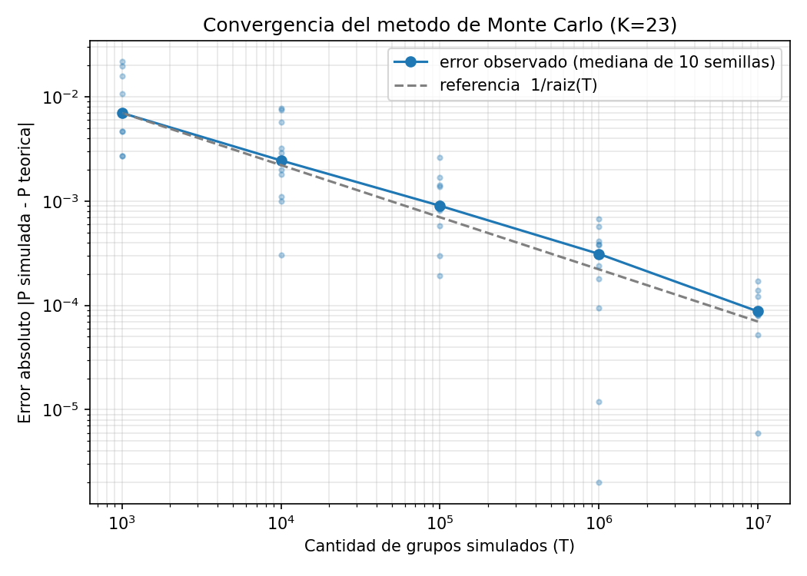

La tercera columna es la verificación de la ley de convergencia. Si el error
decae como 1/√T, el producto error × √T debe mantenerse aproximadamente
constante, y efectivamente se mantiene entre 0.22 y 0.31 **a lo largo de cuatro
órdenes de magnitud**. En el gráfico, en escala logarítmica en ambos ejes, los
puntos siguen una recta paralela a la referencia 1/√T.

La consecuencia práctica es importante y constituye la limitación de fondo del
método de Monte Carlo: **para reducir el error a la décima parte hay que
simular cien veces más grupos**. Pasar de mil a diez millones de simulaciones
(diez mil veces más trabajo) mejoró la precisión apenas unas ochenta veces. Por
eso el método resulta conveniente cuando basta con una precisión moderada, y
deja de serlo cuando se exigen muchas cifras significativas.

La nube de puntos del gráfico muestra además la dispersión entre semillas: con
T pequeño los resultados varían mucho de una corrida a otra, mientras que con T
grande todas las semillas se agrupan en un rango estrecho.

### 5.2 Curva P(K)

Se simularon grupos de 2 a 100 personas, con un millón de grupos para cada
tamaño, y se comparó la frecuencia observada contra la fórmula analítica.

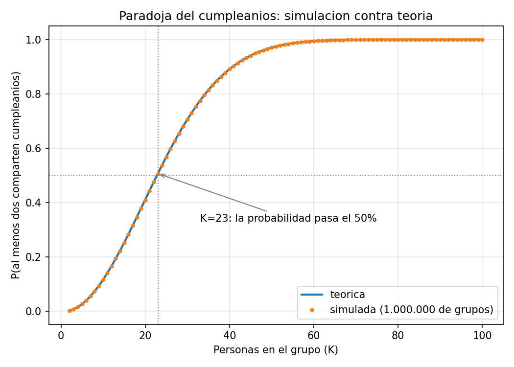

Las dos curvas se superponen en toda su extensión. La mayor discrepancia en los
99 valores de K es de **0.00136** (en K=20), del orden del error
estadístico esperable para un millón de muestras.

| K | P simulada | P teórica | Diferencia |
| - | ---------- | --------- | ---------- |
| 10 | 0.1169 | 0.1169 | 0.0001 |
| 23 | 0.5064 | 0.5073 | 0.0009 |
| 30 | 0.7056 | 0.7063 | 0.0007 |
| 41 | 0.9030 | 0.9032 | 0.0002 |
| 57 | 0.9903 | 0.9901 | 0.0001 |
| 70 | 0.9992 | 0.9992 | 0.0001 |

El gráfico muestra con claridad por qué el resultado se considera
contraintuitivo: la curva **no crece de manera lineal**. Arranca muy lenta
(con 10 personas la probabilidad es de apenas 12%), se dispara en la zona
central cruzando el 50% en K=23, y luego se aplana acercándose asintóticamente
a 1 sin alcanzarlo nunca hasta K=366. La intuición suele suponer un crecimiento
proporcional, y de ahí la respuesta habitual de 183 personas.

### 5.3 Speedup y eficiencia

Mediciones realizadas en la notebook de Nicolás (ver
`resultados/nicolas/maquina-nicolas.txt`), simulando 2.000.000 de grupos con K=23.
Cada configuración se ejecutó **10 veces** y se reporta la **mediana**, tal
como pide la consigna. Se incluye además el promedio recortado (descartando el
valor mínimo y el máximo) como verificación independiente.

| Procesos | Mediana (s) | Speedup | Eficiencia | Prom. recortado (s) | Speedup |
| -------- | ----------- | ------- | ---------- | ------------------- | ------- |
| 1        | 1.325       | 1.00    | 1.00       | 1.334               | 1.00    |
| 2        | 0.661       | 2.00    | 1.00       | 0.664               | 2.01    |
| 4        | 0.328       | 4.05    | 1.01       | 0.332               | 4.02    |
| 6        | 0.233       | 5.68    | 0.95       | 0.234               | 5.69    |
| 8        | 0.205       | 6.47    | 0.81       | 0.208               | 6.40    |

Fórmulas utilizadas: **Sp = T1 / Tp** y **Ep = Sp / p**.

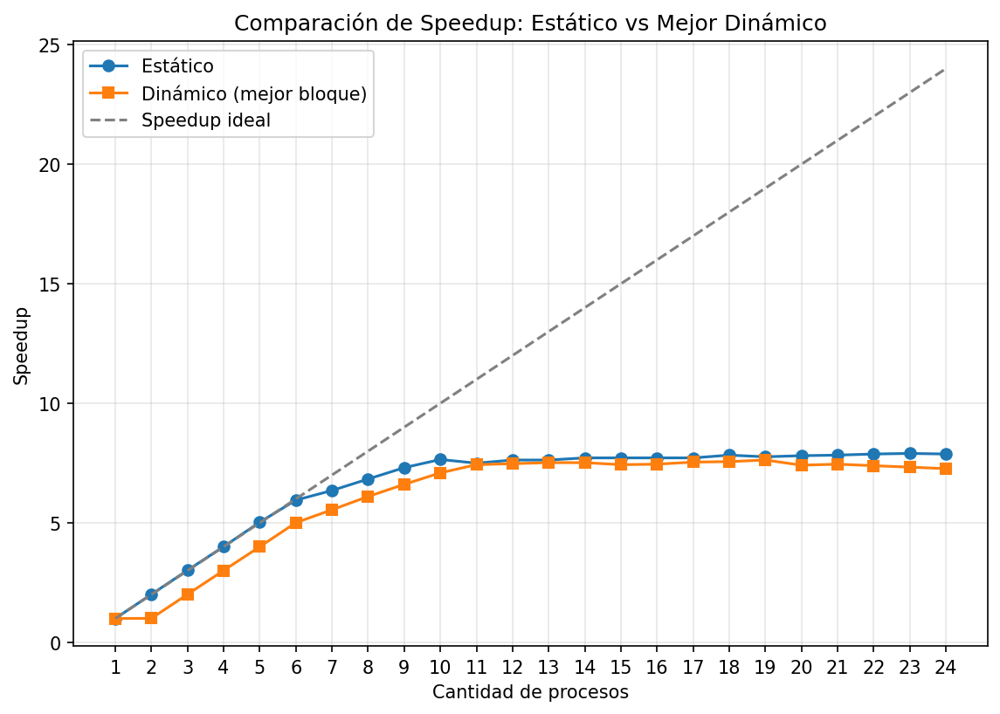

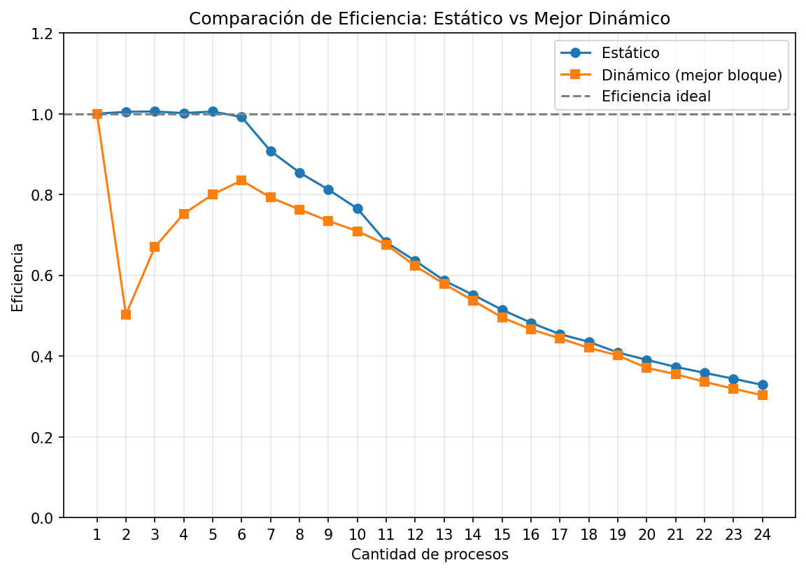

Observaciones:

- Hasta 4 procesos el speedup es prácticamente **lineal**, con eficiencia
  cercana al 100%. Es el comportamiento esperable en un problema
  vergonzosamente paralelo, donde la comunicación es despreciable frente al
  cómputo.
- Con 6 procesos la eficiencia todavía se mantiene alta (0.95).
- Con 8 procesos la eficiencia cae a 0.81. La causa es el hardware: el
  procesador de esta notebook tiene 6 núcleos de alto rendimiento y 4 de
  eficiencia energética. Al pasar de 6 procesos, el sistema operativo empieza
  a asignar procesos a los núcleos lentos, y como el tiempo de la corrida es
  el del proceso más demorado, esos núcleos frenan al conjunto.
- La coincidencia entre la mediana y el promedio recortado (diferencias
  menores al 1%) indica que las mediciones fueron estables y que no hubo
  corridas anómalas que distorsionen las conclusiones.

### 5.4 Comparación: Estático vs Dinámico

Para comparar ambas estrategias se midieron en cinco escenarios:
1. **Desktop de Sergio (SMT desactivado / 8 núcleos físicos, 8 hilos):** AMD Ryzen 7 9800X3D.
2. **Desktop de Sergio (SMT activado / 8 núcleos físicos, 16 hilos):** AMD Ryzen 7 9800X3D.
3. **Cluster CCAD UNC (2 sockets AMD EPYC 7B12 de 64 núcleos c/u = 128 núcleos totales, entorno JupyterLab limitado a 96 núcleos):** hasta 192 procesos.
4. **Notebook de Nicolás (Apple M2 Pro, 10 núcleos heterogéneos: 6 de rendimiento + 4 de eficiencia):** hasta 24 procesos.
5. **Equipo de Francisco:** hasta 24 procesos.

Para el dinámico se reporta el mejor tamaño de bloque encontrado para cada cantidad de procesos.

#### Caso 1: Desktop de Sergio con SMT desactivado (8 núcleos físicos / 8 hilos, T_serial = 0.601 s)

| Procesos | T. Estático (s) | Speedup Est. | Efic. Est. | T. Dinámico (s) | Speedup Din. | Efic. Din. | Mejor Bloque |
| -------- | --------------- | ------------ | ---------- | --------------- | ------------ | ---------- | ------------ |
| 2        | 0.286           | 2.10         | 1.05       | 0.572           | 1.05         | 0.53       | 42.553       |
| 4        | 0.146           | 4.12         | 1.03       | 0.192           | 3.13         | 0.78       | 4.255        |
| 6        | 0.096           | 6.26         | 1.04       | 0.115           | 5.23         | 0.87       | 425          |
| 7        | 0.082           | 7.33         | 1.05       | 0.096           | 6.26         | 0.89       | 425          |
| 8        | 0.072           | 8.35         | 1.04       | 0.082           | 7.33         | 0.92       | 425          |
| 9        | 0.096           | 6.26         | 0.70       | 0.083           | 7.24         | 0.80       | 425          |
| 10       | 0.087           | 6.91         | 0.69       | 0.084           | 7.15         | 0.72       | 425          |
| 12       | 0.086           | 6.99         | 0.58       | 0.083           | 7.24         | 0.60       | 4.255        |
| 14       | 0.089           | 6.75         | 0.48       | 0.082           | 7.33         | 0.52       | 425          |
| 16       | 0.087           | 6.91         | 0.43       | 0.083           | 7.24         | 0.45       | 4.255        |
| 20       | 0.096           | 6.26         | 0.31       | 0.083           | 7.24         | 0.36       | 4.255        |
| 24       | 0.099           | 6.07         | 0.25       | 0.087           | 6.91         | 0.29       | 425          |

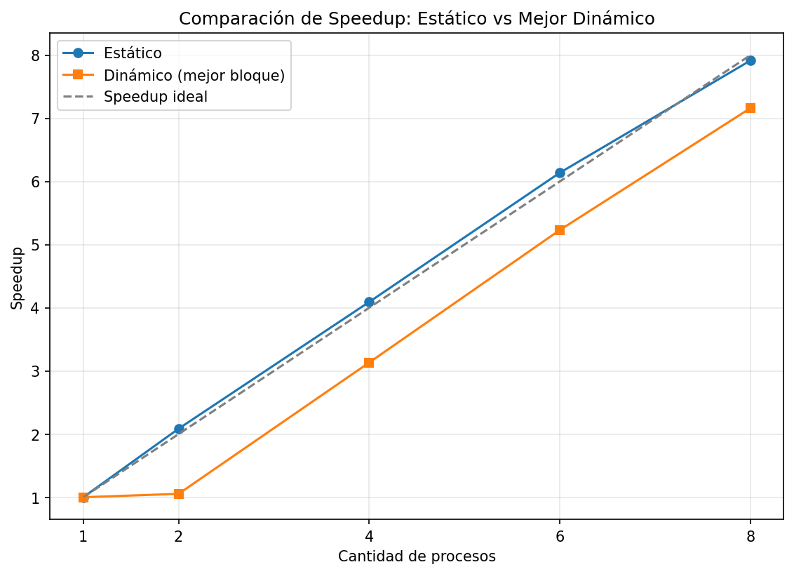

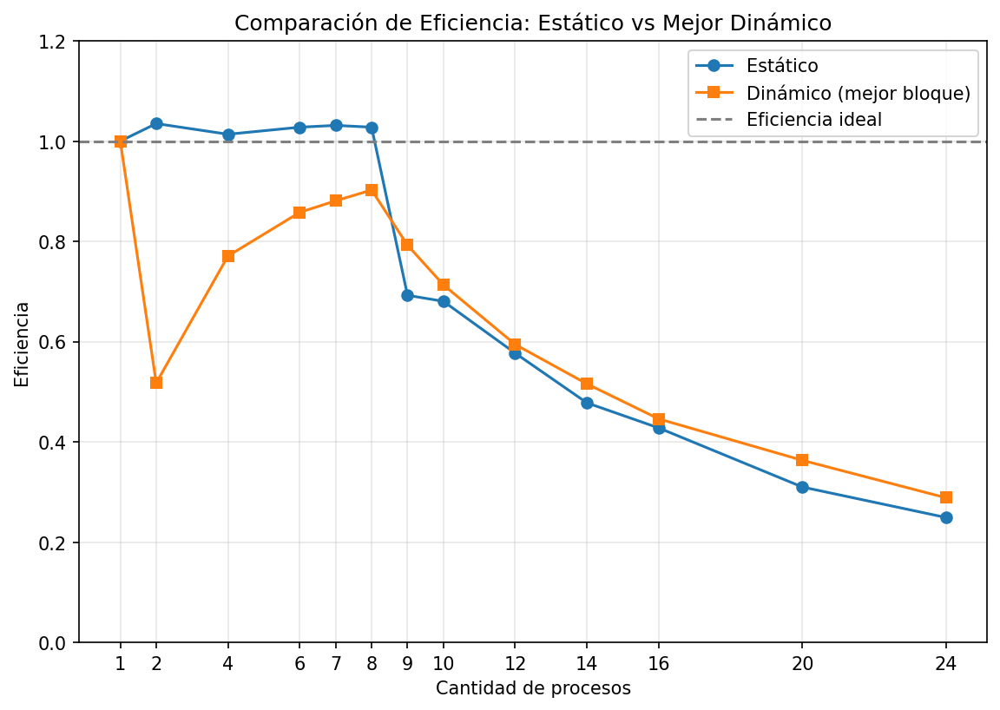

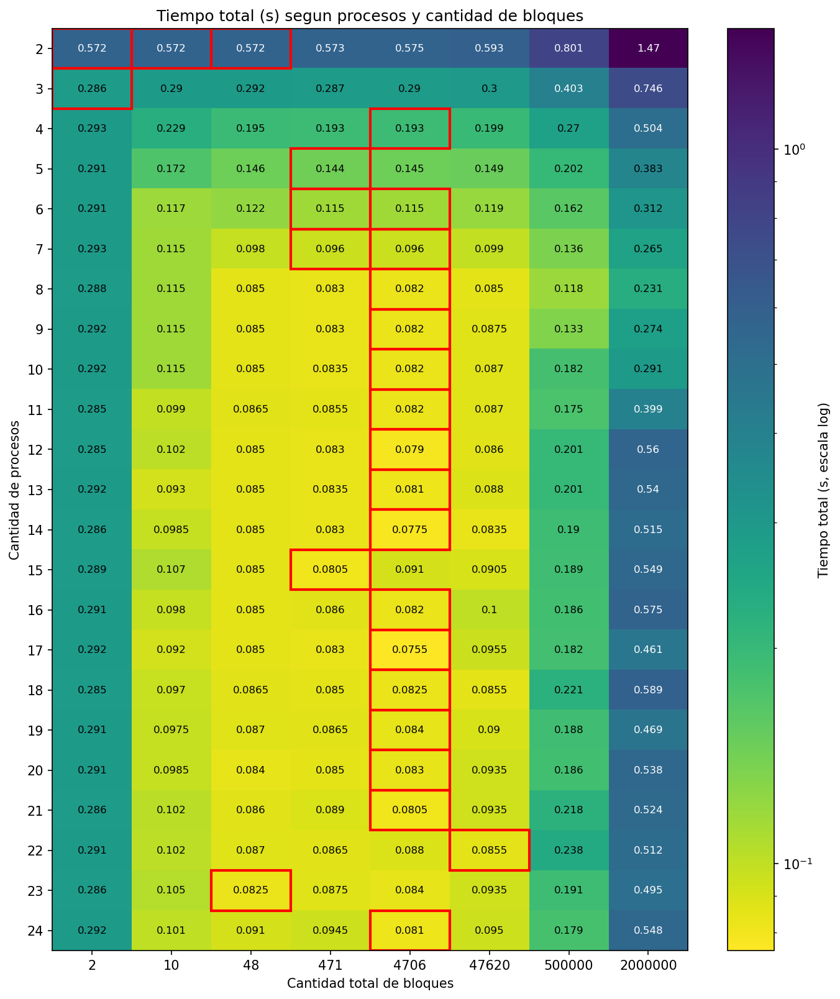

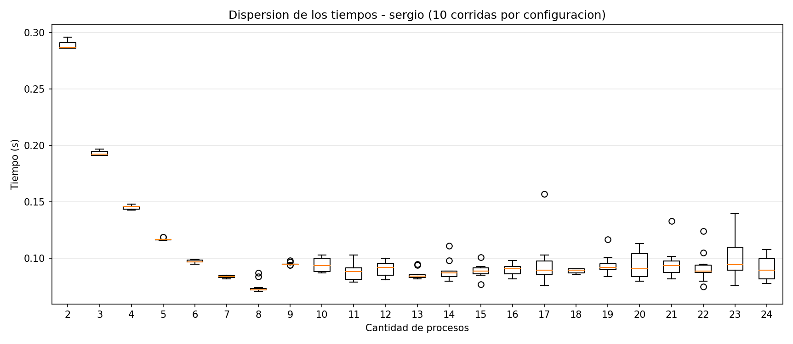

#### Caso 2: Desktop de Sergio con SMT activado (8 núcleos físicos / 16 hilos lógicos, T_serial = 0.601 s)

| Procesos | T. Estático (s) | Speedup Est. | Efic. Est. | T. Dinámico (s) | Speedup Din. | Efic. Din. | Mejor Bloque |
| -------- | --------------- | ------------ | ---------- | --------------- | ------------ | ---------- | ------------ |
| 2        | 0.287           | 2.09         | 1.05       | 0.573           | 1.05         | 0.52       | 4.255        |
| 4        | 0.146           | 4.12         | 1.03       | 0.192           | 3.13         | 0.78       | 425          |
| 6        | 0.101           | 5.95         | 0.99       | 0.116           | 5.18         | 0.86       | 4.255        |
| 7        | 0.088           | 6.83         | 0.98       | 0.097           | 6.20         | 0.89       | 425          |
| 8        | 0.082           | 7.33         | 0.92       | 0.087           | 6.91         | 0.86       | 425          |
| 9        | 0.083           | 7.24         | 0.80       | 0.080           | 7.51         | 0.83       | 425          |
| 10       | 0.078           | 7.71         | 0.77       | 0.074           | 8.12         | 0.81       | 425          |
| 12       | 0.067           | 8.97         | 0.75       | 0.064           | 9.39         | 0.78       | 425          |
| 14       | 0.058           | 10.36        | 0.74       | 0.058           | 10.36        | 0.74       | 4.255        |
| 16       | 0.052           | 11.56        | 0.72       | 0.055           | 10.93        | 0.68       | 4.255        |
| 17       | 0.064           | 9.39         | 0.55       | 0.055           | 10.93        | 0.64       | 4.255        |
| 20       | 0.062           | 9.69         | 0.48       | 0.054           | 11.13        | 0.56       | 425          |
| 24       | 0.063           | 9.54         | 0.40       | 0.054           | 11.13        | 0.46       | 425          |


#### Caso 3: Cluster CCAD UNC (Dual AMD EPYC 7B12, límite 96 núcleos asignados, T_serial = 2.319 s)

| Procesos | T. Estático (s) | Speedup Est. | Efic. Est. | T. Dinámico (s) | Speedup Din. | Efic. Din. | Mejor Bloque |
| -------- | --------------- | ------------ | ---------- | --------------- | ------------ | ---------- | ------------ |
| 2        | 1.157           | 2.00         | 1.00       | 2.310           | 1.00         | 0.50       | 200.000      |
| 4        | 0.580           | 4.00         | 1.00       | 0.775           | 2.99         | 0.75       | 4.255        |
| 6        | 0.388           | 5.98         | 1.00       | 0.465           | 4.99         | 0.83       | 4.255        |
| 8        | 0.292           | 7.94         | 0.99       | 0.333           | 6.96         | 0.87       | 425          |
| 12       | 0.194           | 11.95        | 1.00       | 0.213           | 10.89        | 0.91       | 425          |
| 16       | 0.146           | 15.88        | 0.99       | 0.156           | 14.87        | 0.93       | 425          |
| 24       | 0.099           | 23.42        | 0.98       | 0.102           | 22.74        | 0.95       | 425          |
| 32       | 0.074           | 31.34        | 0.98       | 0.076           | 30.51        | 0.95       | 425          |
| 48       | 0.050           | 46.38        | 0.97       | 0.050           | 46.38        | 0.97       | 425          |
| 64       | 0.037           | 62.68        | 0.98       | 0.038           | 61.03        | 0.95       | 425          |
| 96       | 0.026           | 89.19        | 0.93       | 0.027           | 85.89        | 0.89       | 425          |
| 97       | 0.027           | 85.89        | 0.89       | 0.027           | 85.89        | 0.89       | 425          |
| 128      | 0.034           | 68.21        | 0.53       | 0.031           | 74.81        | 0.58       | 425          |
| 160      | 0.031           | 74.81        | 0.47       | 0.029           | 79.97        | 0.50       | 425          |
| 192      | 0.036           | 64.42        | 0.34       | 0.026           | 89.19        | 0.46       | 425          |

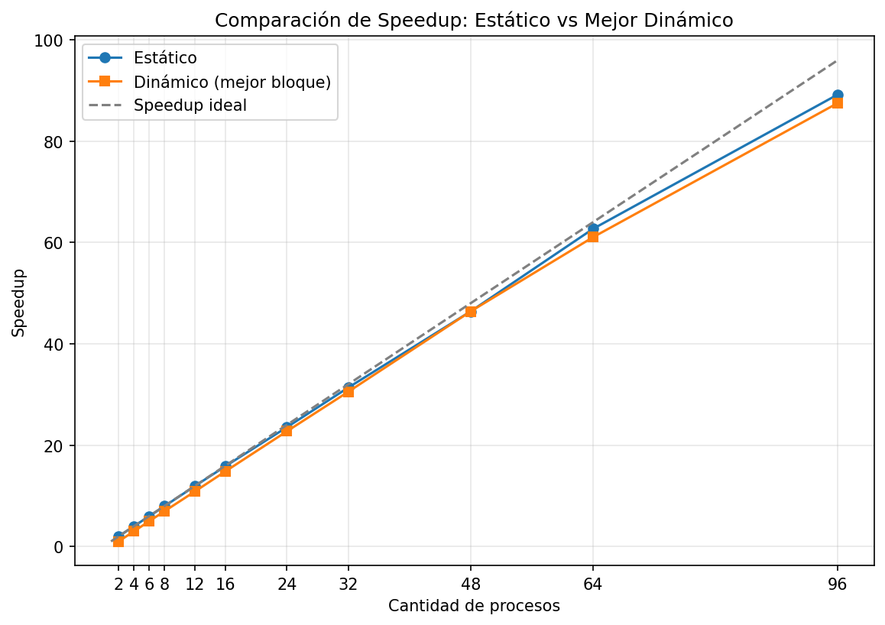

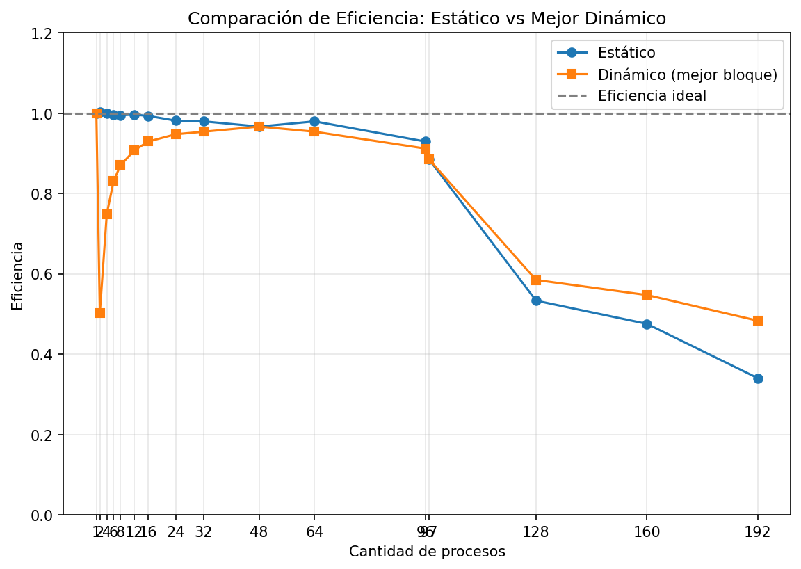

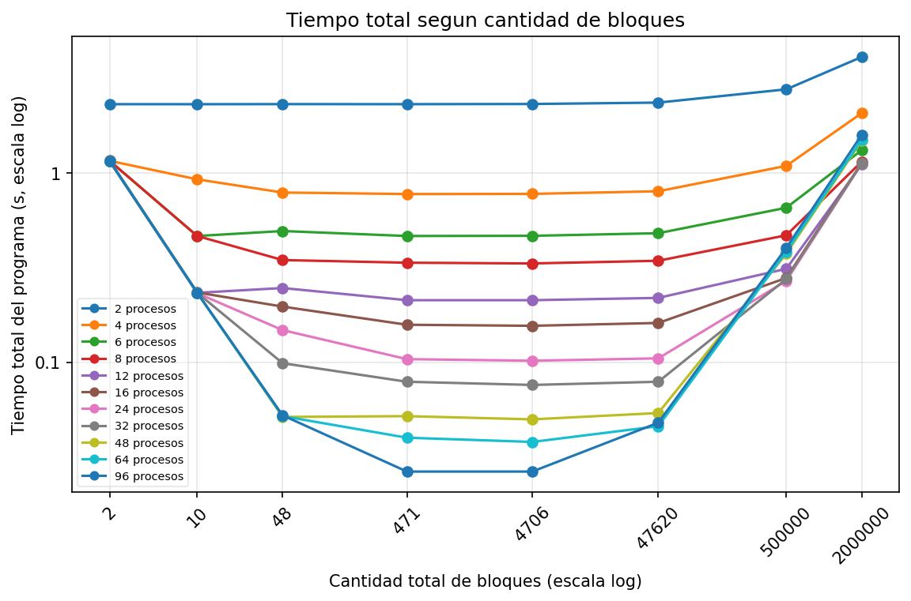

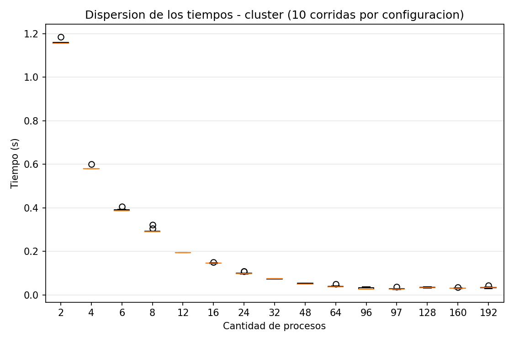

#### Caso 4: Notebook de Nicolás (Apple M2 Pro, 6 núcleos de rendimiento + 4 de eficiencia, T_serial = 1.312 s)

| Procesos | T. Estático (s) | Speedup Est. | Efic. Est. | T. Dinámico (s) | Speedup Din. | Efic. Din. | Mejor Bloque |
| -------- | --------------- | ------------ | ---------- | --------------- | ------------ | ---------- | ------------ |
| 2        | 0.653           | 2.01         | 1.00       | 1.305           | 1.01         | 0.50       | 4.255        |
| 4        | 0.328           | 4.01         | 1.00       | 0.436           | 3.01         | 0.75       | 4.255        |
| 6        | 0.221           | 5.95         | 0.99       | 0.262           | 5.01         | 0.83       | 200.000      |
| 7        | 0.206           | 6.35         | 0.91       | 0.236           | 5.55         | 0.79       | 4.255        |
| 8        | 0.192           | 6.83         | 0.85       | 0.215           | 6.10         | 0.76       | 4.255        |
| 9        | 0.179           | 7.31         | 0.81       | 0.199           | 6.61         | 0.73       | 425          |
| 10       | 0.171           | 7.65         | 0.77       | 0.185           | 7.09         | 0.71       | 4.255        |
| 12       | 0.172           | 7.63         | 0.64       | 0.175           | 7.48         | 0.62       | 200.000      |
| 14       | 0.170           | 7.72         | 0.55       | 0.174           | 7.52         | 0.54       | 42.553       |
| 16       | 0.170           | 7.72         | 0.48       | 0.176           | 7.45         | 0.47       | 200.000      |
| 20       | 0.168           | 7.81         | 0.39       | 0.177           | 7.41         | 0.37       | 42.553       |
| 24       | 0.167           | 7.88         | 0.33       | 0.180           | 7.27         | 0.30       | 42.553       |

A diferencia de los otros escenarios, este procesador es **heterogéneo**: sus
diez núcleos no son equivalentes, ya que seis están orientados a rendimiento y
cuatro a eficiencia energética. Esto se refleja en la curva del estático, que
mantiene eficiencia cercana a 1.00 hasta 6 procesos (la cantidad de núcleos
rápidos) y luego se degrada progresivamente en lugar de hacerlo de golpe como
en las máquinas homogéneas: al incorporar núcleos lentos el tiempo total pasa a
estar determinado por ellos, ya que la corrida termina cuando termina el
proceso más demorado. El speedup se estanca en torno a 7.9 a partir de los 10
procesos.

#### Eficiencia por trabajador: una comparación más justa

Las tablas anteriores comparan ambos esquemas a igual cantidad de **procesos**,
pero en el dinámico el proceso 0 no simula: con P procesos hay solo P−1
trabajadores. Al normalizar la eficiencia del dinámico por la cantidad de
trabajadores reales se observa que la penalización no proviene del esquema en
sí, sino del proceso dedicado a coordinar:

| Procesos | Efic. estático | Efic. dinámico (sobre P) | Efic. dinámico (sobre P−1 trabajadores) |
| -------- | -------------- | ------------------------ | --------------------------------------- |
| 2        | 1.00           | 0.50                     | 1.01                                    |
| 3        | 1.01           | 0.67                     | 1.00                                    |
| 4        | 1.00           | 0.75                     | 1.00                                    |
| 5        | 1.01           | 0.80                     | 1.00                                    |
| 6        | 0.99           | 0.83                     | 1.00                                    |

Mientras la cantidad de trabajadores no supera los núcleos rápidos disponibles,
cada trabajador del esquema dinámico rinde igual que un proceso del esquema
estático (eficiencia ≈ 1.00 en ambos). El esquema dinámico no es intrínsecamente
menos eficiente: su costo es exactamente un proceso de coordinación, que pesa
mucho con pocos procesos (con 2 procesos se pierde la mitad del poder de
cómputo) y se diluye a medida que aumenta la cantidad de trabajadores.


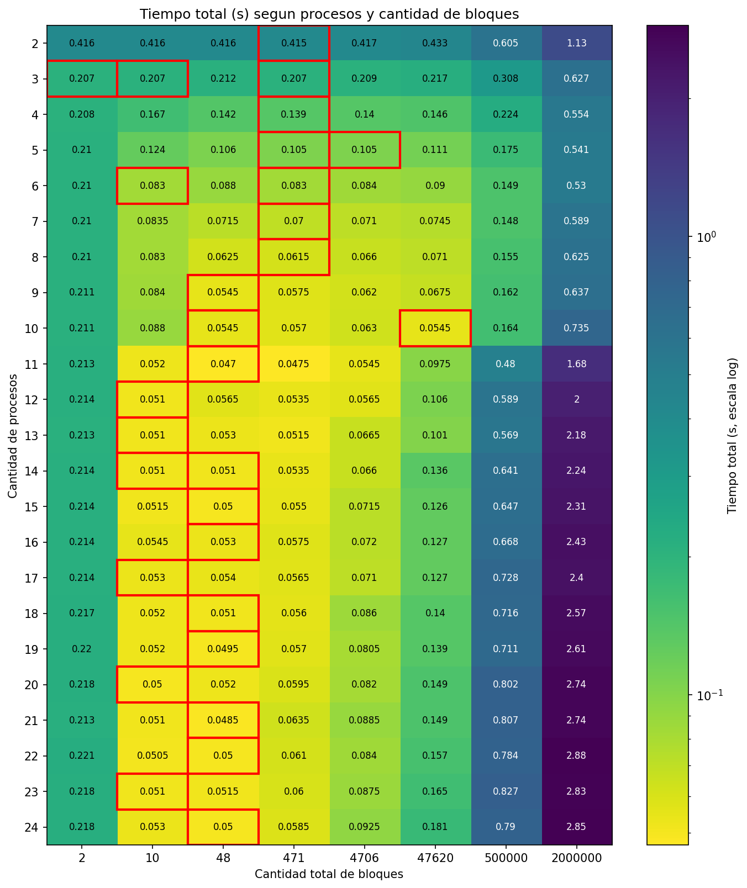

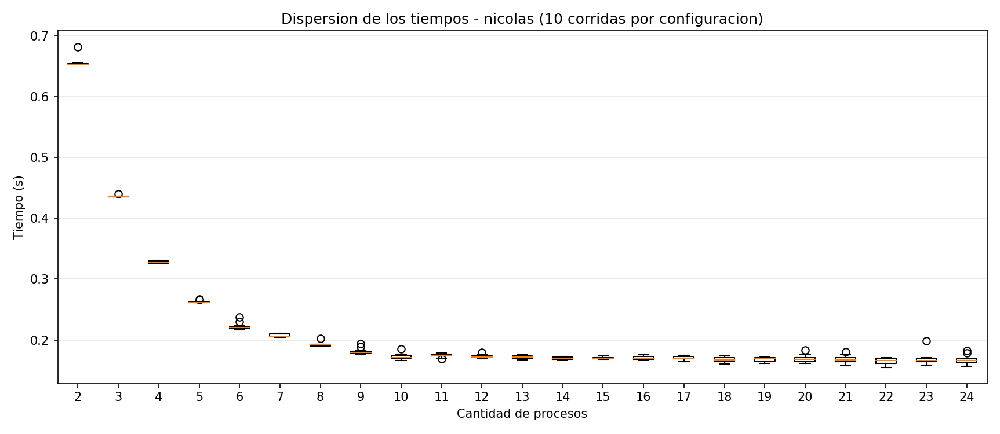

#### Caso 5: Equipo de Francisco (T_serial = 1.812 s)

| Procesos | T. Estático (s) | Speedup Est. | Efic. Est. | T. Dinámico (s) | Speedup Din. | Efic. Din. | Mejor Bloque |
| -------- | --------------- | ------------ | ---------- | --------------- | ------------ | ---------- | ------------ |
| 2 | 0.927 | 1.96 | 0.98 | 1.843 | 0.98 | 0.49 | 42.553 |
| 4 | 0.477 | 3.80 | 0.95 | 0.635 | 2.86 | 0.71 | 425 |
| 6 | 0.369 | 4.91 | 0.82 | 0.415 | 4.36 | 0.73 | 425 |
| 8 | 0.298 | 6.07 | 0.76 | 0.328 | 5.53 | 0.69 | 4.255 |
| 9 | 0.360 | 5.03 | 0.56 | 0.326 | 5.56 | 0.62 | 4.255 |
| 10 | 0.344 | 5.27 | 0.53 | 0.319 | 5.68 | 0.57 | 425 |
| 12 | 0.345 | 5.25 | 0.44 | 0.317 | 5.72 | 0.48 | 42.553 |
| 14 | 0.331 | 5.48 | 0.39 | 0.315 | 5.75 | 0.41 | 4.255 |
| 16 | 0.343 | 5.29 | 0.33 | 0.307 | 5.90 | 0.37 | 4.255 |
| 20 | 0.366 | 4.95 | 0.25 | 0.314 | 5.78 | 0.29 | 42.553 |
| 24 | 0.350 | 5.17 | 0.22 | 0.310 | 5.85 | 0.24 | 4.255 |

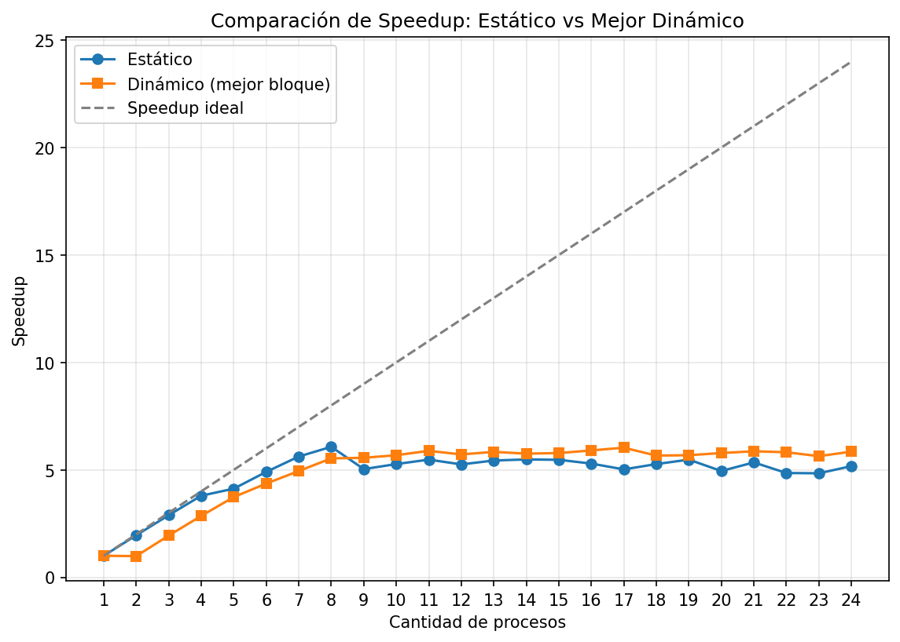

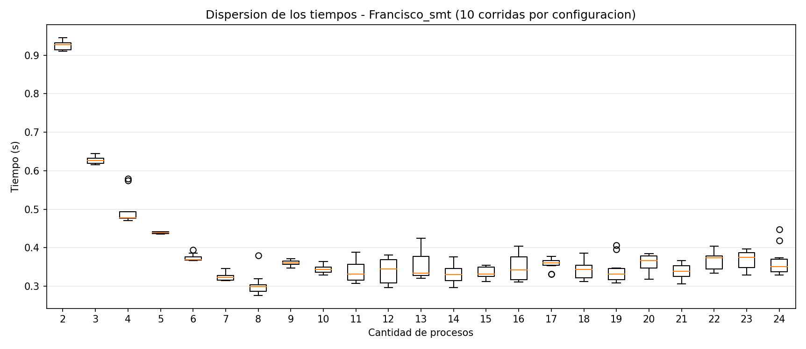

> **Falta completar:** la carpeta `resultados/Francisco_smt/` no incluye el
> archivo con la descripción del hardware, por lo que no es posible interpretar
> en qué punto esta máquina agota sus núcleos físicos ni compararla con las
> demás. Hay que agregar un `maquina.txt` con la salida de `lscpu` o
> `sysctl -n machdep.cpu.brand_string`.

Observaciones y análisis detallado:

- **Efecto de SMT (Simultaneous Multithreading / Hyper-Threading):**
  - Con **SMT desactivado** (8 núcleos / 8 hilos), el mejor tiempo estático se obtiene exactamente en 8 procesos (0.072 s). A partir de 9 procesos el rendimiento estático empeora bruscamente (sube a ~0.096 s) debido al costo de cambio de contexto entre procesos que compiten por los mismos 8 núcleos físicos.
  - Con **SMT activado** (8 núcleos / 16 hilos), el procesador aprovecha las burbujas en los pipelines de ejecución y alcanza un speedup de 11.56 con 16 procesos (0.052 s frente a 0.072 s sin SMT), logrando una mejora real de rendimiento del ~28%.
- **Por qué sobreasignar procesos puede superar a la cantidad de hilos lógicos:**
  - En el caso con SMT activado, en la versión dinámica el tiempo con 20 procesos (0.054 s) es incluso mejor que con 16 procesos (0.055 s).
  - Asimismo, en el cluster CCAD limitado a 96 núcleos, en la versión dinámica con 192 procesos se alcanza un tiempo de **0.026 s**, superando los 0.027 s de 96 procesos y batiendo ampliamente a los 128 procesos (0.031 s).
  - ¿Por qué ocurre esto si la intuición sugiere que 96 procesos debería ser el límite óptimo?
    1. **Ocultamiento de latencia de red/comunicación:** En el dinámico, los procesos pasan una fracción de su tiempo bloqueados en llamadas MPI esperando que el maestro les despache un nuevo bloque. Si hay exactamente 96 procesos para 96 núcleos, cuando un proceso espera en MPI, su núcleo físico queda parcialmente ocioso. Al haber 192 procesos (2 procesos por núcleo asignado), mientras un proceso espera comunicación con el maestro, el planificador del sistema operativo conmuta al otro proceso en ese mismo núcleo para que siga computando de inmediato.
    2. **Sobreasignación asimétrica en el maestro:** El proceso 0 (maestro) pasa la mayor parte del tiempo esperando solicitudes entrantes y no consume el 100% de CPU como un trabajador. Al sobreasignar, los núcleos dedicados a trabajadores tienen siempre trabajo disponible en cola.
    3. **Resiliencia ante la cola del maestro a 128 vs 192 procesos:** Con 128 procesos, el balance entre cambio de contexto y espera no es uniforme (algunos núcleos tienen 1 proceso y otros 2, provocando jitter y desbalance). Con 192 procesos la asignación es exactamente 2 procesos por núcleo lógico asignado (192 / 96 = 2.0), lo que regulariza la carga en el scheduler y optimiza el solapamiento entre I/O MPI y cómputo.
- **El comportamiento del estático frente a la sobreasignación:**
  - En el estático, cada proceso tiene exactamente el mismo trabajo fijo y todos demandan el 100% de CPU continuamente sin esperas de red intermedias.
  - Por esta razón, el estático **no tolera la sobreasignación**: en el cluster decae de 0.026 s (con 96) a 0.034 s (con 128) y 0.036 s (con 192). Al no haber esperas de red que ocultar, el cambio de contexto continuo entre procesos de cómputo puro solo agrega overhead. Por eso, en sobreasignación masiva (192 procesos), el dinámico (0.026 s) supera con claridad al estático (0.036 s).
- **El empate en 48 procesos:**
  - Hasta 48 procesos en el cluster, el estático es superior o empata. En 48 procesos ambos marcan exactamente 0.050 s, punto en el cual el costo del maestro (~2% de los recursos) se amortiza por completo y la cola de mensajes del maestro no experimenta contención.
- **La precisión no depende del tamaño de bloque ni del hardware:**
  - En todos los escenarios, la probabilidad estimada converge a ~0.5070 con 2.000.000 de grupos frente al valor teórico de 0.5073, confirmando que la partición en bloques y la concurrencia no alteran los resultados matemáticos.

### 5.5 Influencia del tamaño del problema

Las mediciones anteriores se realizaron siempre con dos millones de grupos.
Esta sección analiza cómo cambia el speedup al variar el tamaño del problema.
Las mediciones corresponden a la notebook de Nicolás y se reporta la mediana de
las repeticiones de cada configuración.

Conviene distinguir dos magnitudes que podrían confundirse: **T**, la cantidad
de grupos simulados, que determina el volumen total de trabajo, y **K**, la
cantidad de personas por grupo, que determina el trabajo dentro de cada unidad.

#### Variación de la cantidad de grupos (T)

Tiempo de cómputo medido con `MPI_Wtime`, con K=23 y mediana de siete corridas:

| T (grupos) | T_serial | Speedup p=2 | p=4 | p=6 | p=8 | p=10 |
| ---------- | -------- | ----------- | --- | --- | --- | ---- |
| 1.000 | 0.00045 s | 1.81 | 3.75 | 5.56 | 3.33 | 3.38 |
| 10.000 | 0.00456 s | 1.94 | 3.80 | 5.70 | 4.45 | 4.40 |
| 100.000 | 0.04553 s | 1.95 | 3.83 | 5.55 | 4.65 | 5.01 |
| 1.000.000 | 0.45407 s | 1.96 | 3.84 | 5.58 | 5.79 | 5.98 |

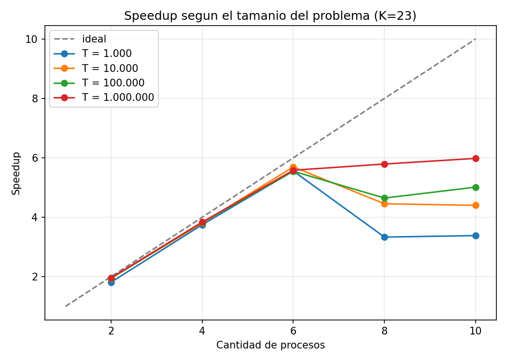

Con pocos procesos el tamaño del problema resulta indiferente: el speedup con
dos, cuatro y seis procesos es prácticamente el mismo para mil grupos que para
un millón. La diferencia aparece con muchos procesos, donde el speedup mejora
sensiblemente al agrandar el problema. Esto ocurre porque existe un costo fijo
por corrida (la barrera de sincronización, la reducción final y la puesta en
marcha de cada proceso) que no depende de T: cuando el trabajo asignado a cada
proceso es pequeño, ese costo representa una fracción considerable del tiempo;
cuando es grande, se diluye.

El efecto resulta mucho más contundente al medir el **tiempo total del
comando**, que incluye la puesta en marcha del entorno MPI (mediana de tres
corridas, con ocho procesos):

| T (grupos) | Serial | 8 procesos | Ganancia real |
| ---------- | ------ | ---------- | ------------- |
| 1.000 | 0.08 s | 0.09 s | 0.89× |
| 10.000 | 0.07 s | 0.10 s | 0.70× |
| 100.000 | 0.11 s | 0.11 s | 1.00× |
| 1.000.000 | 0.52 s | 0.18 s | 2.89× |
| 10.000.000 | 4.61 s | 0.85 s | 5.42× |

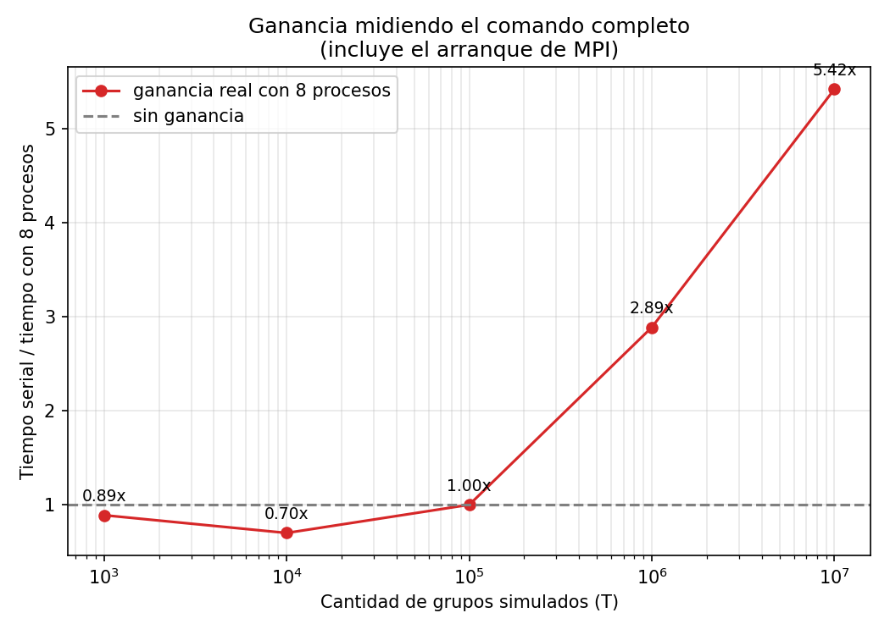

Con problemas pequeños **la versión paralela es más lenta que la serial**: la
ganancia cae por debajo de 1 porque lanzar ocho procesos cuesta más que
simular los grupos. Recién a partir del millón de grupos la paralelización
empieza a rendir, y con diez millones alcanza una ganancia real superior a
cinco veces. El paralelismo solo resulta rentable cuando el trabajo asignado a
cada proceso supera ampliamente el costo de ponerlos en marcha y coordinarlos.

Este comportamiento es una manifestación directa de la **ley de Amdahl**: la
porción no paralelizable del programa (inicialización, sincronización y
reducción) es aproximadamente constante, de modo que su peso relativo disminuye
a medida que crece la parte paralelizable.

#### Variación del tamaño del grupo (K)

Medición con T=1.000.000 fijo y mediana de cinco corridas:

| K (personas) | T_serial | 8 procesos | Speedup |
| ------------ | -------- | ---------- | ------- |
| 5 | 0.3582 s | 0.0672 s | 5.33 |
| 10 | 0.3864 s | 0.0728 s | 5.31 |
| 23 | 0.4576 s | 0.0836 s | 5.47 |
| 50 | 0.5083 s | 0.0879 s | 5.78 |
| 100 | 0.5134 s | 0.0889 s | 5.78 |
| 200 | 0.5166 s | 0.0876 s | 5.90 |

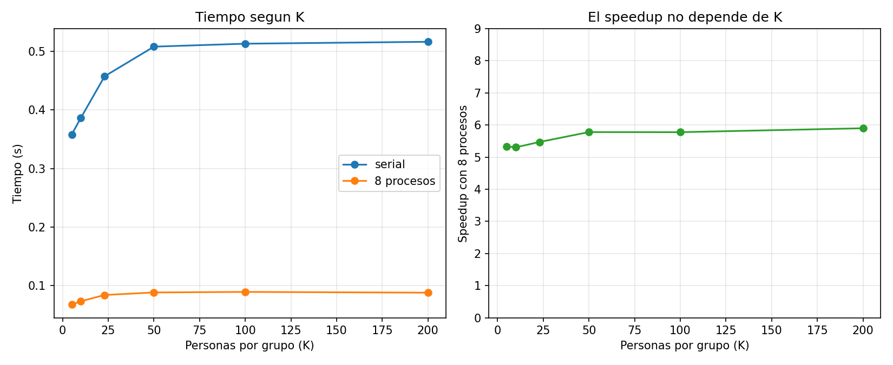

El valor de K prácticamente **no influye sobre el speedup**, que se mantiene
entre 5.3 y 5.9 mientras K varía en un factor de cuarenta. La leve tendencia
creciente es consistente con el mismo argumento anterior (más trabajo por
unidad diluye los costos fijos), pero su magnitud es pequeña comparada con el
efecto de T. El resultado es esperable: modificar K cambia el trabajo contenido
en cada unidad, pero no la forma en que esas unidades se reparten entre los
procesos, que sigue siendo equitativa, ni el volumen de comunicación, que
continúa siendo un único entero por proceso.

Resulta llamativo que el tiempo serial apenas aumente a partir de K=50 pese a
seguir duplicándose la cantidad de personas. La explicación está en el corte
temprano del algoritmo: con cincuenta personas la coincidencia es casi segura,
de modo que el bucle se interrumpe mucho antes de llegar a la última persona y
el resto nunca se sortea.

> **Nota metodológica:** los tiempos de esta sección se midieron con una copia
> de los programas que imprime siete decimales en lugar de tres, porque con mil
> grupos los valores son del orden de la décima de milisegundo y la precisión
> original los redondeaba. Los datos crudos están en `resultados/tamanio/`.

## 6. Conclusiones

1. La simulación reproduce el valor teórico con buena precisión: con 2.000.000 de grupos y K=23 se obtuvo una probabilidad estimada de 0.5070 frente al valor exacto 0.5073, con un error del orden de 0.0003, independiente del tamaño de bloque o esquema utilizado.
2. El paralelismo estático escala de forma casi lineal y con eficiencia cercana al 100% mientras la cantidad de procesos se mantenga dentro de los núcleos físicos o hilos reales disponibles (speedup 8.35 con 8 núcleos en Sergio y 89.19 con 96 procesos en el cluster).
3. **Impacto de SMT/Hyper-Threading:** Activar SMT en la máquina local permitió pasar de un speedup máximo de 8.35 a 11.56 (mejora de ~28%), confirmando que la simulación de Monte Carlo se beneficia del multihilo simultáneo para aprovechar ciclos ociosos del procesador.
4. **Comportamiento en sobreasignación (más procesos que núcleos asignados):**
   - En el esquema **estático**, sobreasignar empeora el rendimiento (de 0.026 s a 0.036 s en el cluster) porque todos los procesos compiten por CPU continua y el costo de cambio de contexto degrada la ejecución sin aportar beneficio.
   - En el esquema **dinámico**, sobreasignar hasta el doble de procesos asignados (192 procesos sobre 96 núcleos en el cluster, o 20-24 procesos sobre 16 hilos en la máquina local) puede **mejorar** el tiempo respecto a configuraciones intermedias o incluso igualar/mejorar el límite nominal (0.026 s en 192 frente a 0.027 s en 96 y 0.034 s en el estático). Esto ocurre porque la sobreasignación permite **ocultar la latencia de comunicación**: mientras un proceso está bloqueado esperando que el maestro le asigne un bloque por MPI, otro proceso aprovecha ese núcleo para seguir calculando.
5. El paralelismo estático es superior al dinámico en escenarios sin sobreasignación debido a la homogeneidad del problema y la ausencia total de comunicación intermedia. Sin embargo, el dinámico resulta más resiliente y eficiente cuando el entorno se sobreasigna fuertemente.
6. En el dinámico, la eficiencia arranca baja (~50% con 2 procesos al haber un solo trabajador), pero crece con la cantidad de procesos a medida que el costo del maestro se diluye entre más trabajadores.
7. El tamaño de bloque en el dinámico presenta un compromiso claro: bloques muy chicos saturan al maestro de mensajes y bloques muy grandes desbalancean la carga al final.

## 7. Mejoras recomendadas para el futuro

- **Histograma de la primera coincidencia:** registrar en qué tamaño de grupo
  aparece la primera coincidencia y graficar su distribución, usando
  `MPI_Gather` para reunir los datos de todos los procesos.
- **Distribución real de nacimientos:** reemplazar el supuesto de días
  equiprobables por datos reales, y cuantificar cuánto aumenta la probabilidad
  de coincidencia respecto del modelo uniforme.
- **Problema generalizado:** permitir años de D días, lo que conecta el
  problema con las colisiones de funciones de hash en criptografía (el llamado
  _birthday attack_).
- **Separar las semillas de los procesos** (por ejemplo `12345 + rango * 7919`)
  y verificar la independencia de las secuencias comparando la estimación que
  produce cada semilla por separado.

## 8. Referencias

Cátedra de Métodos Numéricos II – Computación Científica. (2026). *Computación
de alto rendimiento para aplicaciones numéricas* [Material de clase]. Facultad
de Ciencias Exactas y Tecnología, Universidad Nacional de Tucumán.

Cátedra de Métodos Numéricos II – Computación Científica. (2026). *Trabajo
práctico 1: HPC* [Material de clase]. Facultad de Ciencias Exactas y
Tecnología, Universidad Nacional de Tucumán.

The Open MPI Project. (s.f.). *Open MPI documentation*. Recuperado el 12 de
octubre de 2026, de https://www.open-mpi.org/doc/

> **Falta completar:** estas son las únicas fuentes que efectivamente se
> consultaron para este trabajo. Antes de la entrega hay que agregar la
> bibliografía sobre la paradoja del cumpleaños y sobre el método de Monte
> Carlo, y citarla en el texto donde corresponda (secciones 2 y 3). APA exige
> que toda obra listada aquí aparezca citada en el cuerpo del informe, y
> viceversa.
