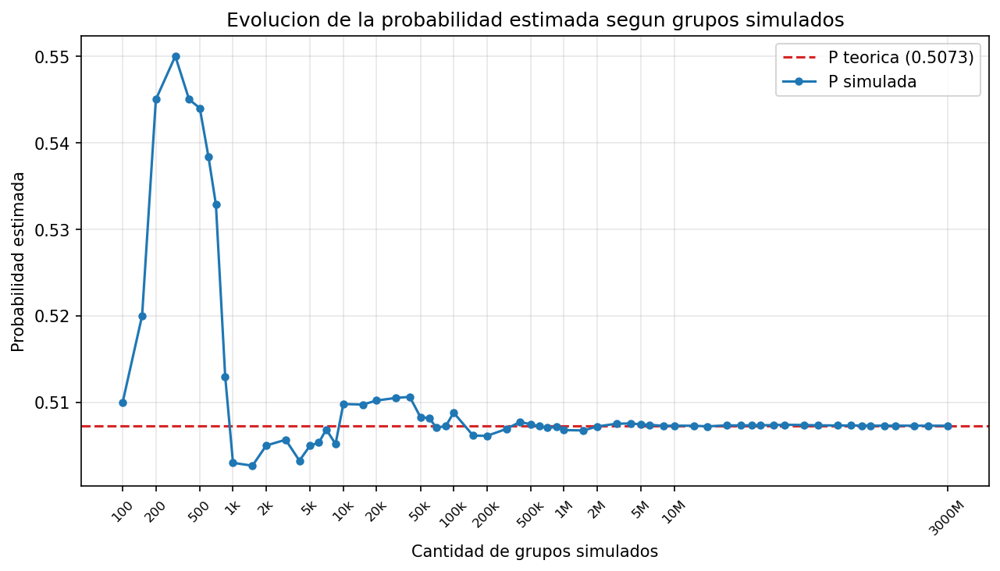
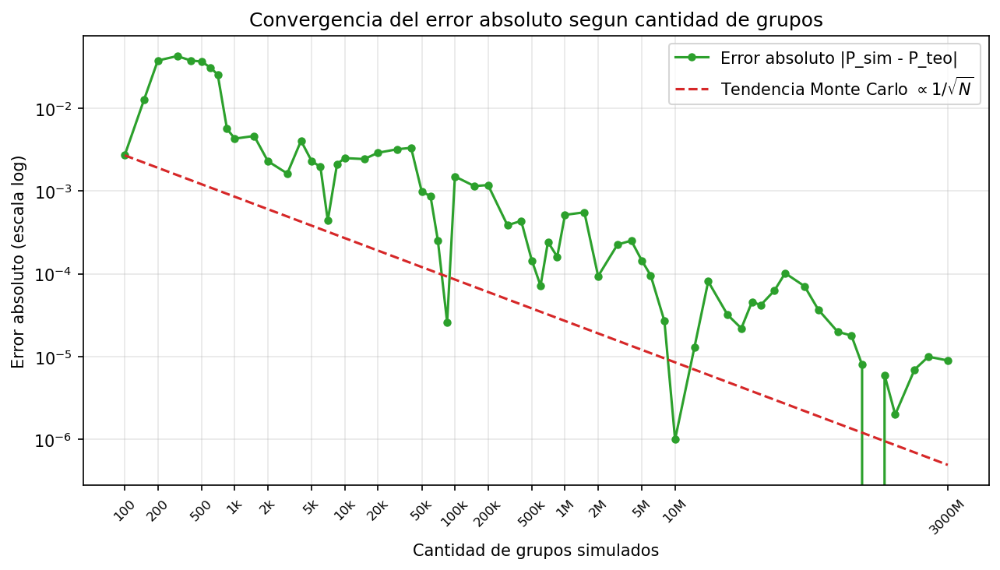
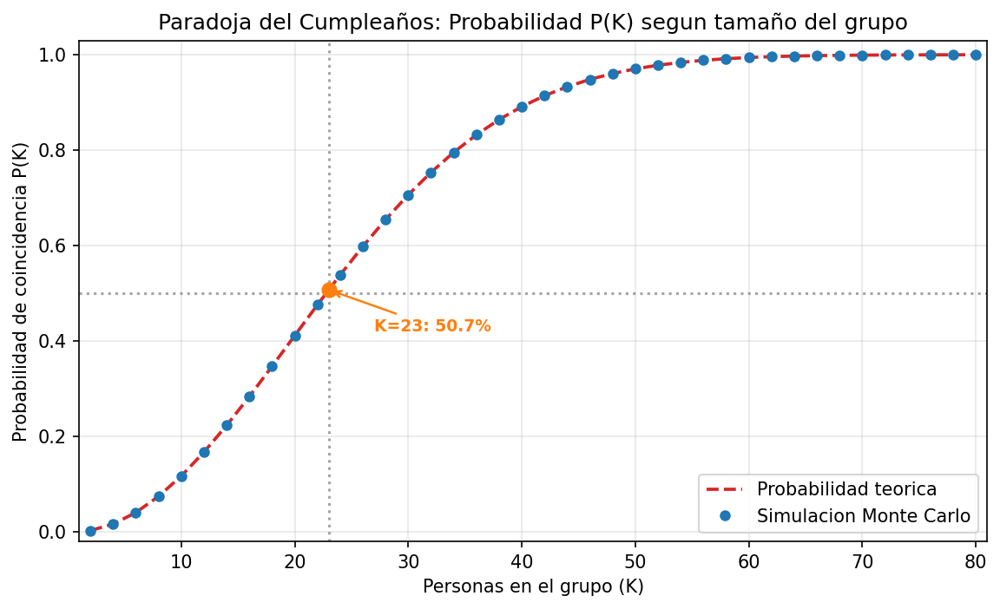
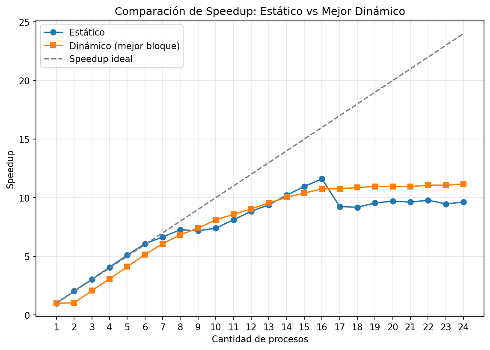
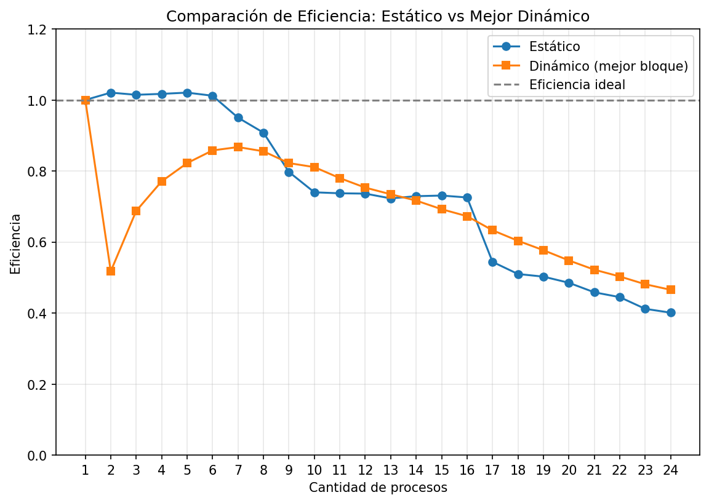
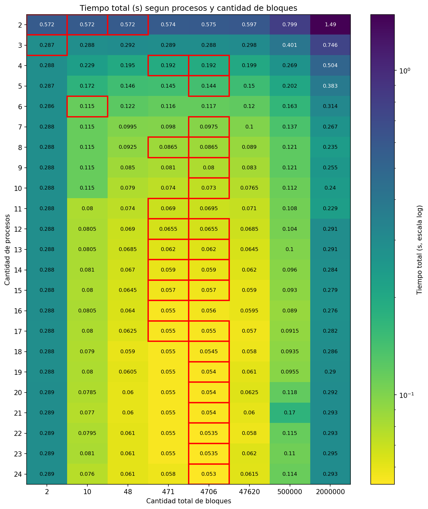
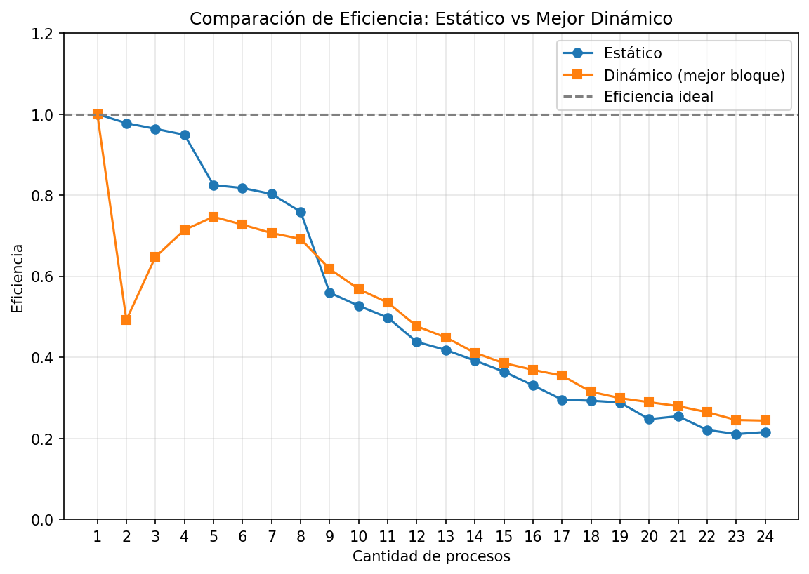
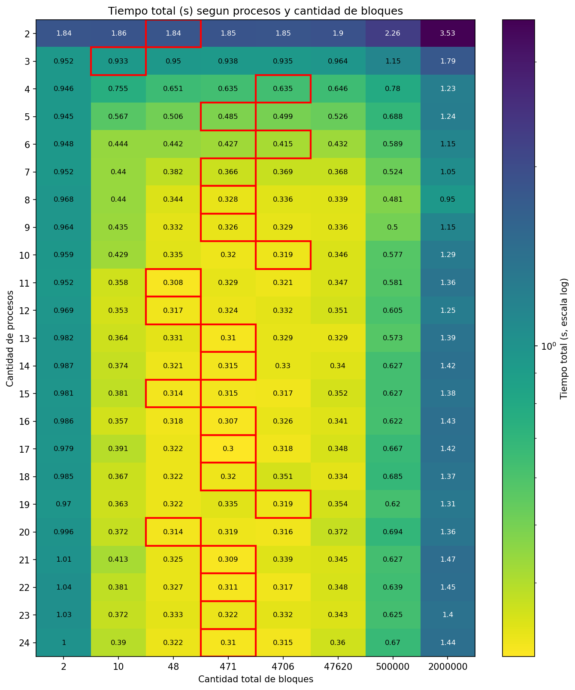
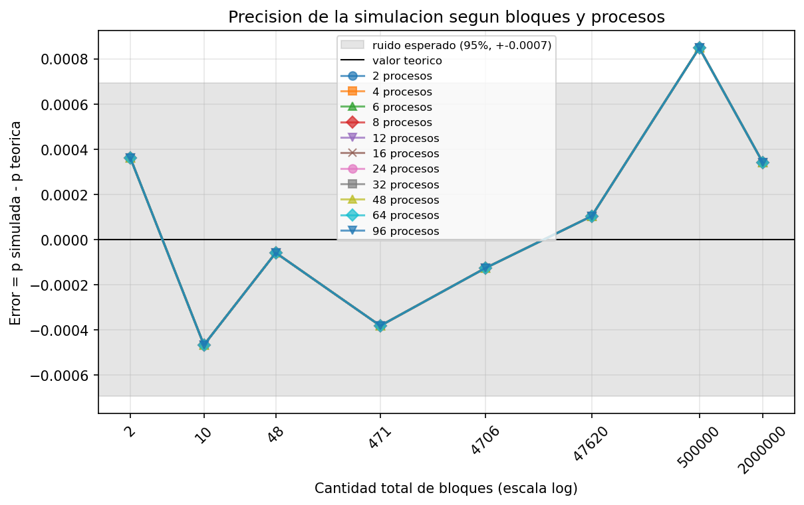

# Paradoja del Cumpleaños: simulación paralela con MPI

**Proyecto 3 — Evaluación Parcial 1**
Métodos Numéricos II / Computación Científica — FACET, UNT — 2026

Integrantes: Ángel Nicolás Magro, Francisco Leccese, Sergio Zair Lobo

---

## 0. Enunciado de la paradoja

La paradoja del cumpleaños establece que si hay 23 personas reunidas hay una
probabilidad del 50,7% de que al menos dos de ellas cumplan años el mismo día.
Para 60 o más personas la probabilidad supera el 99%, y es casi del 100% para
366 personas (contando los años bisiestos).

## 1. El problema

En términos rigurosos no es una paradoja: no hay contradicción lógica, sino una
verdad matemática que choca con la intuición. La respuesta intuitiva suele ser
183 (la mitad de 365), muy lejos del valor correcto K=23. El error está en
pensar en cuántas personas comparten cumpleaños _con uno mismo_ (22
comparaciones), cuando la pregunta es si existe _algún_ par que coincida: en 23
personas hay 23 × 22 / 2 = **253 pares posibles**. Es esa cantidad de pares, y
no la de personas, la que dispara la probabilidad.

## 2. La solución analítica

Calcular en forma directa la probabilidad de al menos una coincidencia es
engorroso (hay que sumar coincidencias de a dos, de a tres, dos pares
separados, etc.). Resulta mucho más simple calcular el **complemento**: la
probabilidad de que _ninguna_ persona comparta cumpleaños, que es un solo caso.

Si las personas entran a la sala de a una:

- La primera tiene 365 días libres: probabilidad de no chocar 365/365 = 1.
- La segunda debe evitar un día: 364/365.
- La tercera debe evitar dos: 363/365.
- Y así hasta la persona K, que evita K−1 días.

Como los cumpleaños son independientes, la probabilidad de que _todas_ eviten a
las anteriores es el producto de esas fracciones, y lo que buscamos es su
complemento:

    P(K) = 1 − (365/365) × (364/365) × ... × ((365 − K + 1)/365)

Evaluando la fórmula se obtienen los valores conocidos:

| K   | P(K)   |
| --- | ------ |
| 10  | 0.1169 |
| 20  | 0.4114 |
| 23  | 0.5073 |
| 30  | 0.7063 |
| 50  | 0.9704 |
| 57  | 0.9901 |

En el código está implementada en la función `probabilidad_teorica` de
`src/cumpleanos.c`.

### Supuestos del modelo

1. **Los 365 días son igualmente probables.** En la realidad los nacimientos no
   son uniformes, lo que vuelve la coincidencia real levemente _mayor_.
2. **No se consideran los años bisiestos** (se ignora el 29 de febrero).
3. **Los cumpleaños son independientes** (no se contemplan mellizos ni
   familiares).

Son los supuestos del enunciado clásico, y los que permiten comparar la
simulación contra una fórmula exacta.

## 3. Metodología de simulación

Para verificar la fórmula en forma empírica usamos el **método de Monte
Carlo**: en lugar de deducir la probabilidad, la observamos generando muchísimos
casos al azar y midiendo con qué frecuencia ocurre el evento.

Algoritmo por grupo:

1. Marcar los 365 días como libres.
2. Para cada una de las K personas, sortear un día entre 0 y 364.
3. Si el día ya está ocupado hay coincidencia: se pasa al grupo siguiente.
4. Si no, marcarlo y continuar.

Repetido para T grupos, la probabilidad estimada es simplemente el cociente
entre grupos con coincidencia y T. La detección usa un arreglo de 365 posiciones
(no comparar todos contra todos), de modo que el costo por grupo es O(K) y no
O(K²).

### Números pseudoaleatorios

`rand()` no es realmente aleatorio sino **pseudoaleatorio**: a partir de una
semilla toda la secuencia queda determinada, lo cual es deseable porque hace el
experimento reproducible. Dos decisiones al respecto:

- **Una semilla distinta por proceso** (`12345 + rango`). Si todos usaran la
  misma, todos simularían los mismos grupos y el paralelismo se desperdiciaría.
- **La misma semilla en todas las repeticiones** de tiempo, de forma que la
  única variable entre corridas sea la cantidad de procesos. Como contrapartida,
  el experimento de convergencia requiere variar la semilla explícitamente.

**Limitación conocida:** las semillas por proceso son consecutivas (12345, 12346, …), que no son estadísticamente independientes entre sí. En las mediciones el efecto no se manifiesta (con 2.000.000 de grupos el error es del orden de la diezmilésima), pero se deja constancia. La solución habitual es separar las semillas (`12345 + rango * 7919`).

## 4. Implementación paralela

### Qué se puede paralelizar

Cada grupo es independiente de los demás: para saber si el grupo 500.000 tiene
una coincidencia no hace falta ningún resultado anterior. Es un problema
**vergonzosamente paralelo**, con parte serial casi nula, así que según la ley
de Amdahl el speedup alcanzable es prácticamente lineal.

### Versión estática (`src/paralelo-estatico.c`)

Los T grupos se reparten en partes iguales entre los P procesos:

```c
mi_cantidad = cantidad / n_procesos;
if (rango < cantidad % n_procesos)
    mi_cantidad++;
```

Cuando la división no es exacta, los primeros procesos absorben el resto; sin
esa corrección se perderían hasta P−1 grupos. Cada proceso simula con la semilla
`12345 + rango` sin comunicarse con los demás.

### Versión dinámica (`src/paralelo-dinamico.c`)

Esquema **maestro-trabajadores**: el proceso 0 (maestro) no simula, solo reparte
bloques a pedido; los procesos 1…P−1 piden un bloque, lo simulan y vuelven a
pedir. Para mantener el determinismo la semilla depende del bloque
(`12345 + id_bloque`), no del proceso. El tamaño de bloque es configurable; por
omisión se asignan unos 20 bloques por trabajador.

### Recolección de resultados

Cada proceso cuenta sus coincidencias y al final se suman con una única
operación colectiva:

```c
MPI_Reduce(&mis_coincidencias, &total_coincidencias, 1, MPI_LONG,
           MPI_SUM, 0, MPI_COMM_WORLD);
```

Se prefiere `MPI_Reduce` a `MPI_Send`/`MPI_Recv` porque resuelve la suma en una
llamada y la implementación puede organizar la comunicación en árbol. Toda la
comunicación se reduce a un entero por proceso, lo que explica el buen speedup.

### Medición del tiempo

Se mide con `MPI_Wtime`, precedido de un `MPI_Barrier` para que todos arranquen
a cronometrar en el mismo instante. El tiempo de la corrida es el **máximo** de
los tiempos de los procesos, no el promedio: el trabajo no termina hasta que
termina el último. Promediar escondería los problemas de balance de carga. La
versión serial se compila también con `mpicc` y mide con `MPI_Wtime` para que
ambos tiempos sean comparables.

## 5. Resultados

### 5.1 Convergencia

Mediciones en el escritorio de Sergio con 8 procesos y K=23
(`resultados/precision/precision.csv`). La probabilidad simulada converge al
valor teórico 0.5073 con la velocidad característica de Monte Carlo,
proporcional a 1/√T.

| Grupos | P simulada | Error abs. |
| ------ | ---------- | ---------- |
| 10.000 | 0.509800 | 0.002503 |
| 100.000 | 0.508800 | 0.001503 |
| 1.000.000 | 0.506781 | 0.000516 |
| 2.000.000 | 0.507203 | 0.000094 |
| 10.000.000 | 0.507296 | 0.000001 |
| 100.000.000 | 0.507399 | 0.000102 |
| 1.000.000.000 | 0.507295 | 0.000002 |





Con pocos grupos (≤ 1.000) el error es grande y oscila alrededor del teórico; a
partir de ~10 millones baja por debajo de la diezmilésima. Con 2.000.000 de
grupos —el tamaño usado en todos los experimentos de speedup— el error ya es de
apenas 0.000094, suficientemente chico para atribuir las diferencias de tiempo
al paralelismo y no al azar.

### 5.2 Curva P(K)

Barrido de K desde 2 hasta 80 personas con 1.000.000 de grupos y 8 procesos
(`resultados/curva_pk/curva_pk.csv`), comparado contra el valor teórico.



| K | P simulada | P teórica |
| - | ---------- | --------- |
| 10 | 0.117114 | 0.116948 |
| 20 | 0.411520 | 0.411438 |
| 23 | 0.506781 | 0.507297 |
| 30 | 0.705987 | 0.706316 |
| 40 | 0.891184 | 0.891232 |
| 50 | 0.970256 | 0.970374 |
| 60 | 0.994035 | 0.994123 |
| 70 | 0.999142 | 0.999160 |
| 80 | 0.999914 | 0.999914 |

La curva simulada sigue a la teórica en todo el rango, con diferencias que no
superan la milésima. El punto K=23 cruza el 50% (0.5068 vs. 0.5073) y para
K ≥ 57 la probabilidad supera el 99%, como anticipa el enunciado.

### 5.3 Speedup y eficiencia

Todas las mediciones usan 2.000.000 de grupos y K=23. Fórmulas: **Sp = T1 / Tp**
y **Ep = Sp / p**. En la notebook de Nicolás cada configuración se ejecutó **10
veces** y se reporta la **mediana**; en las demás máquinas se comparan además las
dos estrategias (estática y dinámica) y, para el dinámico, se reporta el mejor
tamaño de bloque en cada cantidad de procesos.

Se midieron en cinco escenarios:

- **Notebook de Nicolás (Apple M2 Pro, 10 núcleos físicos):** 6 de rendimiento + 4 de eficiencia.
- **Desktop de Sergio (SMT desactivado / 8 núcleos, 8 hilos):** AMD Ryzen 7 9800X3D.
- **Desktop de Sergio (SMT activado / 8 núcleos, 16 hilos):** AMD Ryzen 7 9800X3D.
- **Cluster CCAD UNC (2× AMD EPYC 7B12, 128 CPUs visibles con una cuota de CPU equivalente a 96 núcleos):** hasta 192 procesos.
- **Notebook de Francisco (4 núcleos / 8 hilos, SMT activado):** ASUS TUF Gaming.

#### Caso 0: Notebook de Nicolás (Apple M2 Pro, 10 núcleos físicos, T_serial = 0.419 s)

Máquina: Apple M2 Pro, 10 núcleos (6 de rendimiento + 4 de eficiencia)
(`resultados/nicolas/maquina-nicolas.txt`).

| Procesos | T. Estático (s) | Speedup Est. | Efic. Est. | T. Dinámico (s) | Speedup Din. | Efic. Din. | Mejor Bloque |
| -------- | --------------- | ------------ | ---------- | --------------- | ------------ | ---------- | ------------ |
| 2        | 0.208           | 2.02         | 1.01       | 0.415           | 1.01         | 0.51       | 4.255        |
| 3        | 0.140           | 3.01         | 1.00       | 0.207           | 2.02         | 0.67       | 4.255        |
| 4        | 0.104           | 4.03         | 1.01       | 0.139           | 3.02         | 0.75       | 4.255        |
| 5        | 0.084           | 5.02         | 1.00       | 0.105           | 4.00         | 0.80       | 425          |
| 6        | 0.072           | 5.87         | 0.98       | 0.083           | 5.05         | 0.84       | 4.255        |
| 7        | 0.060           | 6.99         | 1.00       | 0.070           | 5.99         | 0.86       | 4.255        |
| 8        | 0.053           | 7.92         | 0.99       | 0.061           | 6.82         | 0.85       | 4.255        |
| 9        | 0.048           | 8.74         | 0.97       | 0.054           | 7.70         | 0.86       | 42.553       |
| 10       | 0.050           | 8.47         | 0.85       | 0.054           | 7.70         | 0.77       | 42           |
| 11       | 0.049           | 8.56         | 0.78       | 0.047           | 8.93         | 0.81       | 42.553       |
| 12       | 0.048           | 8.74         | 0.73       | 0.051           | 8.23         | 0.69       | 200.000      |
| 13       | 0.051           | 8.23         | 0.63       | 0.051           | 8.23         | 0.63       | 200.000      |
| 14       | 0.051           | 8.15         | 0.58       | 0.051           | 8.23         | 0.59       | 42.553       |
| 15       | 0.046           | 9.02         | 0.60       | 0.050           | 8.39         | 0.56       | 42.553       |
| 16       | 0.046           | 9.12         | 0.57       | 0.053           | 7.92         | 0.49       | 42.553       |
| 17       | 0.049           | 8.56         | 0.50       | 0.053           | 7.92         | 0.47       | 200.000      |
| 18       | 0.050           | 8.47         | 0.47       | 0.051           | 8.23         | 0.46       | 42.553       |
| 19       | 0.047           | 8.93         | 0.47       | 0.050           | 8.47         | 0.45       | 42.553       |
| 20       | 0.046           | 9.12         | 0.46       | 0.050           | 8.39         | 0.42       | 200.000      |
| 21       | 0.050           | 8.39         | 0.40       | 0.049           | 8.65         | 0.41       | 42.553       |
| 22       | 0.048           | 8.74         | 0.40       | 0.050           | 8.39         | 0.38       | 42.553       |
| 23       | 0.046           | 9.02         | 0.39       | 0.051           | 8.23         | 0.36       | 200.000      |
| 24       | 0.050           | 8.47         | 0.35       | 0.050           | 8.39         | 0.35       | 42.553       |


Hasta 8–9 procesos el speedup estático crece casi a la par del número de
procesos, con eficiencia cercana al 100%: el comportamiento esperable en un
problema vergonzosamente paralelo. El máximo (9.12 con 16–20 procesos) ya
implica sobreasignar los 10 núcleos físicos, y de ahí en más la eficiencia cae
por el cambio de contexto. El dinámico arranca penalizado porque el proceso 0 no
simula (eficiencia 0.51 con 2 procesos) y se va acercando al estático a medida
que el costo del maestro se reparte entre más trabajadores.


El mapa de calor del esquema dinámico confirma que el tiempo mínimo se
concentra en tamaños de bloque intermedios (del orden de los cientos a unos
pocos miles de grupos): los bloques muy chicos saturan al maestro de mensajes y
los muy grandes desbalancean la carga al final.

#### Caso 1: Desktop de Sergio con SMT desactivado (T_serial = 0.591 s)

| Procesos | T. Estático (s) | Speedup Est. | Efic. Est. | T. Dinámico (s) | Speedup Din. | Efic. Din. | Mejor Bloque |
| -------- | --------------- | ------------ | ---------- | --------------- | ------------ | ---------- | ------------ |
| 2        | 0.286           | 2.06         | 1.03       | 0.572           | 1.03         | 0.52       | 42.553       |
| 3        | 0.193           | 3.07         | 1.02       | 0.286           | 2.06         | 0.69       | 1.000.000    |
| 4        | 0.146           | 4.04         | 1.01       | 0.193           | 3.07         | 0.77       | 425          |
| 5        | 0.117           | 5.05         | 1.01       | 0.144           | 4.10         | 0.82       | 4.255        |
| 6        | 0.097           | 6.09         | 1.01       | 0.115           | 5.13         | 0.86       | 425          |
| 7        | 0.084           | 7.03         | 1.00       | 0.096           | 6.15         | 0.88       | 425          |
| 8        | 0.072           | 8.20         | 1.03       | 0.082           | 7.20         | 0.90       | 425          |
| 9        | 0.095           | 6.22         | 0.69       | 0.082           | 7.20         | 0.80       | 425          |
| 10       | 0.093           | 6.32         | 0.63       | 0.082           | 7.20         | 0.72       | 425          |
| 11       | 0.088           | 6.67         | 0.61       | 0.082           | 7.20         | 0.65       | 425          |
| 12       | 0.092           | 6.42         | 0.53       | 0.079           | 7.47         | 0.62       | 425          |
| 13       | 0.085           | 6.99         | 0.54       | 0.081           | 7.29         | 0.56       | 425          |
| 14       | 0.087           | 6.79         | 0.48       | 0.077           | 7.62         | 0.54       | 425          |
| 15       | 0.089           | 6.63         | 0.44       | 0.081           | 7.34         | 0.49       | 4.255        |
| 16       | 0.091           | 6.49         | 0.41       | 0.082           | 7.20         | 0.45       | 425          |
| 17       | 0.089           | 6.60         | 0.39       | 0.075           | 7.82         | 0.46       | 425          |
| 18       | 0.089           | 6.60         | 0.37       | 0.083           | 7.16         | 0.40       | 425          |
| 19       | 0.092           | 6.42         | 0.34       | 0.084           | 7.03         | 0.37       | 425          |
| 20       | 0.091           | 6.49         | 0.32       | 0.083           | 7.11         | 0.36       | 425          |
| 21       | 0.093           | 6.32         | 0.30       | 0.081           | 7.34         | 0.35       | 425          |
| 22       | 0.089           | 6.63         | 0.30       | 0.085           | 6.91         | 0.31       | 42           |
| 23       | 0.095           | 6.25         | 0.27       | 0.083           | 7.16         | 0.31       | 42.553       |
| 24       | 0.089           | 6.60         | 0.27       | 0.081           | 7.29         | 0.30       | 425          |


El mejor tiempo estático se da justo en 8 procesos (0.072 s). A partir de 9 el
rendimiento empeora bruscamente por el costo de cambio de contexto entre
procesos que compiten por los mismos 8 núcleos físicos.


El mapa de calor muestra una banda clara de mínima temperatura alrededor de los
8 procesos y bloques pequeños: pasado ese umbral, el calor se intensifica hacia
la derecha y hacia abajo, reflejando el sobrecosto del cambio de contexto cuando
hay más procesos que núcleos físicos.

#### Caso 2: Desktop de Sergio con SMT activado (T_serial = 0.592 s)

| Procesos | T. Estático (s) | Speedup Est. | Efic. Est. | T. Dinámico (s) | Speedup Din. | Efic. Din. | Mejor Bloque |
| -------- | --------------- | ------------ | ---------- | --------------- | ------------ | ---------- | ------------ |
| 2        | 0.290           | 2.04         | 1.02       | 0.572           | 1.03         | 0.52       | 42.553       |
| 3        | 0.195           | 3.04         | 1.01       | 0.287           | 2.06         | 0.69       | 1.000.000    |
| 4        | 0.145           | 4.07         | 1.02       | 0.192           | 3.08         | 0.77       | 425          |
| 5        | 0.116           | 5.10         | 1.02       | 0.144           | 4.11         | 0.82       | 425          |
| 6        | 0.098           | 6.07         | 1.01       | 0.115           | 5.15         | 0.86       | 200.000      |
| 7        | 0.089           | 6.65         | 0.95       | 0.098           | 6.07         | 0.87       | 425          |
| 8        | 0.082           | 7.26         | 0.91       | 0.086           | 6.84         | 0.86       | 425          |
| 9        | 0.083           | 7.18         | 0.80       | 0.080           | 7.40         | 0.82       | 425          |
| 10       | 0.080           | 7.40         | 0.74       | 0.073           | 8.11         | 0.81       | 425          |
| 11       | 0.073           | 8.11         | 0.74       | 0.069           | 8.58         | 0.78       | 4.255        |
| 12       | 0.067           | 8.84         | 0.74       | 0.066           | 9.04         | 0.75       | 425          |
| 13       | 0.063           | 9.40         | 0.72       | 0.062           | 9.55         | 0.73       | 425          |
| 14       | 0.058           | 10.21        | 0.73       | 0.059           | 10.03        | 0.72       | 425          |
| 15       | 0.054           | 10.96        | 0.73       | 0.057           | 10.39        | 0.69       | 425          |
| 16       | 0.051           | 11.61        | 0.73       | 0.055           | 10.76        | 0.67       | 4.255        |
| 17       | 0.064           | 9.25         | 0.54       | 0.055           | 10.76        | 0.63       | 425          |
| 18       | 0.065           | 9.18         | 0.51       | 0.054           | 10.86        | 0.60       | 425          |
| 19       | 0.062           | 9.55         | 0.50       | 0.054           | 10.96        | 0.58       | 425          |
| 20       | 0.061           | 9.70         | 0.49       | 0.054           | 10.96        | 0.55       | 425          |
| 21       | 0.061           | 9.63         | 0.46       | 0.054           | 10.96        | 0.52       | 425          |
| 22       | 0.060           | 9.79         | 0.44       | 0.053           | 11.07        | 0.50       | 425          |
| 23       | 0.062           | 9.47         | 0.41       | 0.053           | 11.07        | 0.48       | 425          |
| 24       | 0.061           | 9.63         | 0.40       | 0.053           | 11.17        | 0.47       | 425          |





Con SMT activado el procesador aprovecha las burbujas de los pipelines y alcanza
un speedup de 11.61 con 16 procesos (0.051 s frente a 0.072 s sin SMT), una
mejora real del ~42%.



Con SMT la franja fría se extiende más allá de los 8 procesos, llegando hasta
los 16 hilos lógicos; incluso con sobreasignación (más procesos que hilos) el
dinámico mantiene bolsones de bajo tiempo, posiblemente porque oculta la latencia de
comunicación con el maestro.

#### Caso 3: Cluster CCAD UNC (T_serial = 2.319 s)

| Procesos | T. Estático (s) | Speedup Est. | Efic. Est. | T. Dinámico (s) | Speedup Din. | Efic. Din. | Mejor Bloque |
| -------- | --------------- | ------------ | ---------- | --------------- | ------------ | ---------- | ------------ |
| 2        | 1.156           | 2.01         | 1.00       | 2.309           | 1.00         | 0.50       | 200.000      |
| 4        | 0.580           | 4.00         | 1.00       | 0.774           | 2.99         | 0.75       | 4.255        |
| 6        | 0.388           | 5.98         | 1.00       | 0.465           | 4.99         | 0.83       | 4.255        |
| 8        | 0.291           | 7.96         | 0.99       | 0.333           | 6.97         | 0.87       | 425          |
| 12       | 0.194           | 11.96        | 1.00       | 0.213           | 10.89        | 0.91       | 425          |
| 16       | 0.146           | 15.89        | 0.99       | 0.156           | 14.87        | 0.93       | 425          |
| 24       | 0.099           | 23.55        | 0.98       | 0.102           | 22.74        | 0.95       | 425          |
| 32       | 0.074           | 31.34        | 0.98       | 0.076           | 30.52        | 0.95       | 425          |
| 48       | 0.050           | 46.39        | 0.97       | 0.050           | 46.39        | 0.97       | 425          |
| 64       | 0.037           | 62.69        | 0.98       | 0.038           | 61.04        | 0.95       | 425          |
| 96       | 0.026           | 89.21        | 0.93       | 0.0265          | 87.53        | 0.91       | 425          |
| 97       | 0.027           | 85.91        | 0.89       | 0.027           | 85.91        | 0.89       | 425          |
| 128      | 0.034           | 68.22        | 0.53       | 0.031           | 74.82        | 0.58       | 425          |
| 160      | 0.030           | 76.05        | 0.48       | 0.0265          | 87.53        | 0.55       | 425          |
| 192      | 0.036           | 65.34        | 0.34       | 0.025           | 92.78        | 0.48       | 425          |


El estático escala casi a la par del número de núcleos hasta los 96 (speedup
89.21, eficiencia 0.93), pero se derrumba en cuanto se sobreasigna (0.53 con 128
procesos, 0.34 con 192). El dinámico lo acompaña de cerca y, con la sobreasignación
masiva de 192 procesos sobre 96 núcleos, termina superándolo (0.025 s frente a
0.036 s), porque mientras un trabajador espera que el maestro le asigne el
siguiente bloque, otro proceso ocupa ese núcleo y sigue calculando: la
sobreasignación oculta la latencia de comunicación.


En el cluster la región de menor tiempo del esquema dinámico forma una franja
alargada a lo largo de los 96 núcleos con bloques pequeños. Con sobreasignación
(128–192 procesos) el mapa muestra que el dinámico sigue conservando bolsones
fríos (incluso mejores que con 96), posiblemente porque el reparto a pedido permite
rellenar los huecos que deja la espera de mensajes del maestro.

#### Caso 4: Notebook de Francisco con SMT activado (T_serial = 1.812 s)

Máquina: ASUS TUF Gaming, 4 núcleos físicos / 8 hilos lógicos
(`resultados/Francisco_smt/maquina-francisco.txt`).

| Procesos | T. Estático (s) | Speedup Est. | Efic. Est. | T. Dinámico (s) | Speedup Din. | Efic. Din. | Mejor Bloque |
| -------- | --------------- | ------------ | ---------- | --------------- | ------------ | ---------- | ------------ |
| 2        | 0.927           | 1.96         | 0.98       | 1.843           | 0.98         | 0.49       | 42.553       |
| 3        | 0.627           | 2.89         | 0.96       | 0.933           | 1.94         | 0.65       | 200.000      |
| 4        | 0.477           | 3.80         | 0.95       | 0.635           | 2.86         | 0.71       | 425          |
| 5        | 0.440           | 4.12         | 0.82       | 0.485           | 3.73         | 0.75       | 4.255        |
| 6        | 0.369           | 4.91         | 0.82       | 0.415           | 4.36         | 0.73       | 425          |
| 7        | 0.323           | 5.62         | 0.80       | 0.366           | 4.95         | 0.71       | 4.255        |
| 8        | 0.298           | 6.07         | 0.76       | 0.328           | 5.53         | 0.69       | 4.255        |
| 9        | 0.360           | 5.03         | 0.56       | 0.326           | 5.56         | 0.62       | 4.255        |
| 10       | 0.344           | 5.27         | 0.53       | 0.319           | 5.68         | 0.57       | 425          |
| 11       | 0.331           | 5.48         | 0.50       | 0.308           | 5.88         | 0.53       | 42.553       |
| 12       | 0.345           | 5.25         | 0.44       | 0.317           | 5.72         | 0.48       | 42.553       |
| 13       | 0.334           | 5.43         | 0.42       | 0.310           | 5.84         | 0.45       | 4.255        |
| 14       | 0.331           | 5.48         | 0.39       | 0.315           | 5.75         | 0.41       | 4.255        |
| 15       | 0.332           | 5.47         | 0.36       | 0.314           | 5.78         | 0.39       | 42.553       |
| 16       | 0.343           | 5.29         | 0.33       | 0.307           | 5.90         | 0.37       | 4.255        |
| 17       | 0.361           | 5.02         | 0.30       | 0.300           | 6.03         | 0.35       | 4.255        |
| 18       | 0.344           | 5.27         | 0.29       | 0.320           | 5.66         | 0.31       | 4.255        |
| 19       | 0.331           | 5.48         | 0.29       | 0.319           | 5.68         | 0.30       | 425          |
| 20       | 0.366           | 4.95         | 0.25       | 0.314           | 5.78         | 0.29       | 42.553       |
| 21       | 0.339           | 5.35         | 0.25       | 0.309           | 5.87         | 0.28       | 4.255        |
| 22       | 0.373           | 4.85         | 0.22       | 0.311           | 5.82         | 0.26       | 4.255        |
| 23       | 0.374           | 4.84         | 0.21       | 0.322           | 5.64         | 0.25       | 4.255        |
| 24       | 0.350           | 5.17         | 0.22       | 0.310           | 5.85         | 0.24       | 4.255        |




Con solo 4 núcleos, perder el proceso 0 en el dinámico cuesta el 25% del cómputo,
por eso el estático lidera hasta saturar los 8 hilos lógicos (0.298 s). A partir
de 9 procesos el estático se degrada por el cambio de contexto, mientras el
dinámico aguanta mejor ocultando la latencia de comunicación. Su mejor tiempo está en 17
procesos (0.300 s), aunque sin bajar del piso que imponen sus 8 hilos (speedup
estancado en ~6).



En la notebook de Francisco el mapa de calor es más compacto: con solo 4 núcleos
la franja fría se acota a la zona de 8 hilos y, más allá, el calor avanza con
fuerza. El dinámico resiste un poco mejor la sobreasignación, pero nunca escapa
del piso que imponen sus 8 hilos lógicos.

Sobre la precisión: en el esquema dinámico la semilla de cada bloque es
`12345 + id_bloque`, así que cambiar el tamaño de bloque cambia cuántos bloques
(y qué semillas) se usan. El diagrama siguiente muestra el error
(p simulada − p teórica) en el cluster: oscila alrededor de cero según la
cantidad de bloques, sin tendencia clara, porque la convergencia al valor
teórico 0.5073 depende del sorteo de semillas propio de Monte Carlo y no del
hardware ni del número de procesos. Con 2.000.000 de grupos el error ya es
del orden de la diezmilésima en todos los casos.



## 6. Conclusiones

  1. La simulación reproduce el valor teórico con buena precisión: con 2.000.000 de grupos y K=23 se obtuvo una probabilidad estimada de 0.5070 frente al valor exacto 0.5073, con un error del orden de la diezmilésima, independiente del tamaño de bloque o esquema utilizado.
  2. El paralelismo estático escala de forma casi lineal y con eficiencia cercana al 100% mientras la cantidad de procesos se mantenga dentro de los núcleos físicos o hilos reales disponibles (speedup 8.20 con 8 núcleos en Sergio y 89.21 con 96 procesos en el cluster).
  3. **SMT/Hyper-Threading:** activar SMT subió el speedup máximo de 8.20 a 11.61 (~42%), confirmando que la simulación de Monte Carlo se beneficia del multihilo simultáneo para aprovechar ciclos ociosos del procesador.
  4. **Sobreasignación (más procesos que núcleos):**
    - En el esquema **estático**, sobreasignar empeora el rendimiento (de 0.026 s a 0.036 s en el cluster) porque todos los procesos compiten por CPU continua y el costo de cambio de contexto degrada la ejecución sin aportar beneficio.
    - En el esquema **dinámico**, sobreasignar (192 procesos sobre 96 núcleos en el cluster, o 20-24 procesos sobre 16 hilos en la máquina local) puede **mejorar** el tiempo respecto a configuraciones intermedias e incluso igualar/mejorar el límite nominal (0.025 s en 192 frente a 0.0265 s en 96 y 0.026 s en el estático). Esto ocurre porque la sobreasignación permite **ocultar la latencia de comunicación**: mientras un proceso está bloqueado esperando que el maestro le asigne un bloque por MPI, otro proceso aprovecha ese núcleo para seguir calculando.
  5. El paralelismo estático es superior al dinámico en escenarios sin sobreasignación debido a la homogeneidad del problema y la ausencia total de comunicación intermedia. Sin embargo, el dinámico resulta más resiliente y eficiente cuando el entorno se sobreasigna fuertemente.
  6. En el dinámico, la eficiencia arranca baja (~50% con 2 procesos al haber un solo trabajador), pero crece con la cantidad de procesos a medida que el costo del maestro se diluye entre más trabajadores.
  7. El tamaño de bloque en el dinámico presenta un compromiso claro: bloques muy chicos saturan al maestro de mensajes y bloques muy grandes desbalancean la carga al final, El tamaño de bloque óptimo depende de la máquina: en Sergio y el cluster ronda los 425 grupos, mientras que en las notebooks (Francisco y Nicolás) se corre hacia bloques mayores (4.255 a 200.000), porque el costo de comunicación por bloque es más alto.

### 6.1 ¿Cuándo le gana el dinámico al estático?

- **Con SMT y sobreasignación** (Sergio con 16 hilos lógicos): el dinámico
  alcanza ~11.2 frente a ~9.6 del estático, porque aprovecha mejor los hilos
  lógicos y oculta la latencia.
- **Sobreasignación masiva** (cluster, 192 procesos sobre una cuota de 96 núcleos): el dinámico (0.025 s)
  supera claramente al estático (0.036 s).
- Fuera de esas condiciones el estático es competitivo o superior; alrededor de
  48 procesos en el cluster ambos emparejan (~0.050 s), punto donde el costo del
  maestro se amortiza por completo.

## 7. Mejoras recomendadas para el futuro

- **Histograma de la primera coincidencia:** registrar en qué tamaño de grupo
  aparece la primera coincidencia y graficar su distribución con `MPI_Gather`.
- **Distribución real de nacimientos:** reemplazar el supuesto de días
  equiprobables por datos reales y cuantificar cuánto sube la probabilidad.
- **Problema generalizado:** permitir años de D días, lo que conecta el problema
  con las colisiones de hash en criptografía (_birthday attack_).
- **Semilla configurable por línea de comandos**, necesaria para el experimento
  de convergencia con repeticiones independientes.
- **Separar las semillas de los procesos** (por ejemplo `12345 + rango * 7919`)
  y verificar la independencia de las secuencias.
